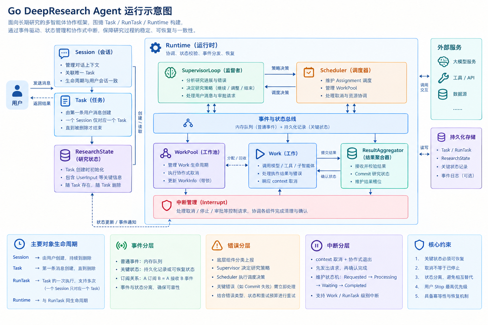

# DeepResearch Agent 项目设计说明书

> Version: V0.1
> Language: Go
> Agent Framework: Eino
> HTTP Framework: CloudWeGo Hertz
> Project Positioning: Supervisor-driven DeepResearch Agent System

---

## 关于架构设计与代码实现的约定

本文档用于帮助 AI 理解项目的整体架构、模块职责、核心数据关系与预期运行流程，为后续代码生成和迭代开发提供参考。

文档中给出的结构体、接口、字段、方法及模块划分均为建议性设计，旨在帮助 AI 更准确地理解系统意图，并非必须严格遵循的实现规范。

在实际编码过程中，AI 可以根据 Go 语言特性、Eino 框架的实际能力、现有代码结构及实现复杂度，对具体设计进行调整，包括但不限于：

* 合并或拆分结构体、接口与模块。
* 调整字段、方法及类型定义。
* 采用更符合框架惯例的实现方式。
* 在不改变核心设计意图的前提下，简化不必要的抽象。

如果发现现有设计存在技术限制、职责重叠、实现困难或更合理的替代方案，AI 应说明原因并提出建议，而不是机械地照搬文档。

**实现时应优先遵循项目的核心设计意图与关键约束，而非拘泥于具体代码形式。** 对涉及状态一致性、并发安全、研究数据可靠性、Stop/Interrupt 语义及执行恢复的调整，应明确说明其影响，并在必要时与用户讨论确认。


## 1 项目概述

### 1.1 项目背景

传统的 Agent 应用通常采用如下模式：

```text
User
  ↓
Agent
  ↓
Tool
  ↓
Result
  ↓
Answer
```

这种结构适用于简单问答、工具调用以及有限步骤的任务，但对于 DeepResearch 类型任务存在明显不足。

一个完整的研究任务通常具有以下特征：

* 用户目标不一定能够一次性拆解完成；
* 研究过程中会不断产生新的信息；
* 新信息可能改变后续研究方向；
* 不同 Agent 的研究结果之间存在依赖、冲突和互相引用；
* 部分任务可以并行执行；
* 部分任务必须等待其他任务完成；
* Agent 执行可能失败、超时或被中断；
* 研究上下文会不断增长；
* 最终结论并不是某一个 Agent 单独生成，而是多个 Research Result 聚合后形成的；
* 系统需要能够观察当前研究状态，并动态决定“下一步做什么”。

因此，本项目不将 DeepResearch 建模为一个简单的 Planner，而是设计为一个由 **Supervisor Loop 驱动的研究执行系统**。

核心思想：

```text
                ┌──────────────────────┐
                │        User          │
                └──────────┬───────────┘
                           ↓
                    ┌─────────────┐
                    │    Task     │
                    └──────┬──────┘
                           ↓
              ┌────────────────────────┐
              │     Supervisor Loop    │
              │                        │
              │ Observe → Decide       │
              │ → Schedule → Aggregate │
              │ → Re-plan              │
              └───────────┬────────────┘
                          ↓
                    ┌───────────┐
                    │ Scheduler │
                    └─────┬─────┘
                          ↓
               ┌────────────────────┐
               │ Assignment / Work  │
               └─────────┬──────────┘
                         ↓
                 ┌──────────────┐
                 │ Agent / Tool │
                 └──────┬───────┘
                        ↓
                    Research
                     Result
                        ↓
                Result Aggregator
                        ↓
                 Finding Context
                        ↓
                 Supervisor Loop
                        │
                 ┌──────┴──────┐
                 ↓             ↓
             Continue       Complete
```

---

## 2 项目目标

### 2.1 核心目标

构建一个基于 Go + Eino + CloudWeGo 的可扩展 DeepResearch Agent Runtime，实现：

1. 用户研究任务管理；
2. Supervisor 动态规划；
3. Assignment 拆解；
4. 多 Agent 并发执行；
5. 工具调用；
6. Research Result 聚合；
7. Finding Context 管理；
8. 上下文压缩；
9. 任务中断；
10. Checkpoint 持久化；
11. 任务恢复；
12. SSE 实时事件推送；
13. 基础可观测性；
14. 研究过程审计；
15. 后续扩展调度优化和资源管理。

---

## 3 Non-Goals

本项目不试图从第一阶段开始解决所有问题。

以下能力依赖外部基础设施：

### 3.1 LLM

模型推理由外部 LLM Provider 提供。

系统本身不实现基础模型。

---

### 3.2 搜索引擎

Web Search 能力通过 Tool / MCP / 外部 Search API 提供。

系统只负责工具调用和结果管理。

---

### 3.3 数据库

项目自身定义 Repository / Storage 抽象。

具体数据库可以使用：

* SQLite
* PostgreSQL
* Redis
* Object Storage

但核心业务模块不直接依赖具体数据库。

---

### 3.4 向量数据库

RAG / Vector Search 属于 Infrastructure 能力。

核心 Supervisor 不直接依赖某个具体向量数据库。

---

### 3.5 Container Sandbox

如果未来执行不可信代码，需要引入独立 Sandbox。

Sandbox 不属于 DeepResearch Core Runtime。

后续可以接入：

* containerd
* Docker
* Kubernetes
* 独立 Sandbox Service

### 3.6 可观测性

未来可以引进现有的采集和分析组件，实现CPU,内存，时间开销的观测：

后续可接入：

* APM
* ilog

---

## 4 成功标准

项目不是以“能够调用一次 LLM”作为成功标准。

最低成功标准：

```text
User Task
    ↓
Supervisor
    ↓
Assignment
    ↓
Agent
    ↓
Tool
    ↓
Result
    ↓
Finding
    ↓
Supervisor
    ↓
Final Report
```

同时满足：

* 将SubAgent的调用打包成为AgentTool，Supervisor可以像工具一样通过Runtime调用
* Assignment 可以并发执行；
* 单个 Assignment 失败不会直接导致整个 Research Run 崩溃；
* 可以观察任务状态；
* 可以保存运行状态；
* 可以从 Checkpoint 恢复；
* Finding Context 不无限增长；
* Result 与 Conclusion 可以追踪来源；
* 最终结论能够追溯到原始 Research Result。

---

## 5 核心概念模型

整个系统建议明确区分以下对象：

```text
Task
  │
  └── ResearchRun
          │
          ├── Assignment
          │       │
          │       └── Work
          │
          ├── Finding context
          │       ├── Finding
          │       └── Result
          ├── Event
          │
          └── CheckpointID
```

---

### 5.1 Task

Task 表示用户提出的研究目标。

例如：

```text
比较 2025~2026 年主流 AI Agent Framework，
分析其架构、性能、生态以及适用场景。
```

Task 是用户意图的表达，不直接代表一次运行。

建议结构：

```go
type Task struct {
    ID          string
    UserID      string

    Title       string
    Description string

    CreatedAt   time.Time
    UpdatedAt   time.Time
}
```

Task 不应该保存：

* 当前执行中的 Agent；
* 当前 Assignment；
* 当前 goroutine；
* 当前 HTTP Request Context。

这些属于 Runtime。

---

### 5.2 ResearchRun

Task 表示“我要研究什么”。

ResearchRun 表示：

> “这个 Task 的一次具体执行”。

例如用户两次执行同一个 Task：

```text
Task: 比较 Agent Framework

Run #1
Run #2
```

两个 Run 可以拥有完全不同的执行过程。

建议：

```go
type RunTask struct {
    ID       string
    TaskID   string

    Status   RunStatus

    Turn     int

    Budget   RunBudget

    StateVersion int64

    CreatedAt time.Time
    UpdatedAt time.Time
}
```

Run Status：

```text
Created
Running
Paused
Waiting
Completed
Failed
Cancelled
```

---

### 5.3 Supervisor

#### 5.3.1 Supervisor Loop

Supervisor 是整个系统的核心控制器。

它不是简单的 Planner。

Supervisor 每一轮执行：

```text
GetInput
   ↓
Observe
   ↓
Understand Current State
   ↓
Decide
   ↓
Produce Actions
   ↓
Execute Actions
   ↓
Observe Results
   ↓
Next Turn
```

可以定义为：

```go
type SupervisorLoop struct{
    ResearchRunID string

    TurnLoopcfg   TurnLoopConfig
}
```

---

#### 5.3.2 Supervisor 的输入

Supervisor 不应该只接收用户 Prompt，包含以下信息后以将其格式化在Prompt模板中。

所以输入的生成至少需要以下信息：

```text
UserPrompt
ResearchRun(主要检查Turn，如果Turn为0，说明研究尚未开始，需要从零规划)
Assignment State（标识Assignment进度，比如Run，Waiting, Finished）
Research Results(Work 执行完成产生的 Result，格式化在提示词模板中，若没有提交的情况则返回说明对应状态)
Previous Reasoning(用于放置被动中断新推入Result时的推理上下文)
Budget（Token预算）
System Events
```

标识是否存在Tool调用，Messages的产生是Assistant还是User，这些已经封装在Eino已有的Event结构中，具体可见官方文档

按照eino, 一般使用adk方法在Supvisor配置之初就设置系统提示词。

---

#### 5.3.3 Supervisor 的输出

Eino极大方便了输出，工具调用只要在Supervisor实例的时候注入就可以，推理过程以SSE的方式流式输出到前端显示，输出是Event，需要SSE单元消费 ：

例如：

```go
//读通道
_, events := adk.NewAsyncIteratorPair[*adk.AgentEvent]()
//一些执行逻辑....
event, ok := events.Next()
```

---

### 5.4 Assignment

Assignment 是 Supervisor 对研究任务进行拆分后的逻辑工作单元。

例如：

```text
Task:
研究 Agent Framework

Assignment A:
研究 Eino

Assignment B:
研究 LangGraph

Assignment C:
研究 AutoGen

Assignment D:
比较三者架构
```

Assignment 表示：

> “需要完成什么工作”。

它不代表实际运行资源。

---

### 5.5 Work

Work 表示 Assignment 的一次实际执行实例。

这是另一个必须明确的边界：

```text
Assignment = What to do

Work = One execution of that work
```

例如：

```text
Assignment A
   ├── Work #1 → Agent A
   └── Work #2 → Retry
```

建议：

```go
type Work struct {
    mu           *sync.Mutex
    ID           string
    AssignmentID string

    Status       WorkStatus
    Constraint   *WorkConstraint

    WorkerID     string

    StartedAt    time.Time
    FinishedAt   time.Time

    Attempt      int
}

type WorkConsrtraint struct{
    ToolAllowed  []ToolInfo//暂时不用实现
    TimeLimit    time.Duration
}
```

---

### 5.6 Scheduler

Scheduler 不负责决定“研究什么”。

它负责：

> 在已经确定的 Assignment 中，决定哪些现在可以执行，以及如何执行。

核心职责：

* Assignment 排队；
* 并发控制；
* 优先级；  //中立原则，暂时不要实现Assignment 的优先级，但是错误处理可以分优先级
* 依赖检查；
* Worker 分配；
* 超时；
* Retry；
* Cancel；
* Resource Limit。

因此：

```text
Supervisor
    ↓
决定研究什么

Scheduler
    ↓
决定什么时候执行

Work
    ↓
实际执行
```

这是三个必须保持的边界。

---

### 5.7 Assignment Dependency（这部分砍掉，Runtime不应该关心任务优先级，Assignment由模型自己安排，并且发起调用，不需要再考虑Runtime层面调度）

Assignment 可以存在依赖：

```text
A ─────┐
       ↓
       C
       ↑
B ─────┘
```

例如：

```text
A：收集数据
B：分析数据
C：根据 A+B 进行综合判断
```

因此 Assignment 应支持：

```go
type Assignment struct {
    ID string

    Goal string

    Dependencies []string

    Priority int

    Status AssignmentStatus
}
```

Scheduler 只有在：

```text
All Dependencies Completed
```

之后才能调度 Assignment。

---

### 5.8 Research Result

Agent 完成 Work 后产生 Result，commit到Result Aggregator管理。

Result 是：

> 某一次具体执行产生的原始研究产物。

Result 不等于 Finding。

例如：

```text
Result:
“某框架采用 DAG Execution Model……”

Finding:
“该框架的执行模型更适合确定性 Workflow。”
```

Result 更接近证据。

Finding 更接近经过整理后的知识。

---

### 5.9 Result Aggregator

ResultAggregator 负责处理 Result：

```text
Result
 ↓
Validate
 ↓
Normalize
 ↓
Deduplicate
 ↓
Version
 ↓
Route
 ↓
Compressed Findings
```

职责包括：

* Result 接收；
* Result 去重；//暂时不实现
* Result 版本；
* Result 与 Assignment 关联；
* Result 与 Finding 关联
* Result 路由到 SupervisorLoop和Finding Context；
* 处理冲突 Result；
* 触发 Supervisor 新一轮决策。

说明：
 1.Result需要维护一个面板来知晓目前有哪些Assignment以及他们的状态，面板从Schduler接到调用并且实例化Work运行后就要更新，如果Scheduler取消，也要同步。
 2.版号验证：Result->比较时间戳、版本号、ID->校验成功->commited->同步状态->Aggregate
                                    ↓
                                校验失败 -> Fail to commit -> 同步面板状态

---

### 5.10 Research State

ResearchState 是当前 Research Run 的核心知识状态,是模型研究的全部上下文。

建议设计成结构化对象，用图表示关系：

```text
ResearchState
 ├── ID
 ├── Results                 //由Work产生的结果得到
 ├── Finding                 //由Supervisor根据某轮Result、Compressed、Related Finding、FromStorage推理的结果
 ├── Related Findings        //为了得到Finding，Supervisor在前几轮已得出的FindingContext基础上作为支撑，称
 |                             这个FindingContext是该Finding的RelatedFind
 ├── Retriever Context       //Supervisor查询持久化Storage中的上下文，比如通过RAG检索重新召回的上下文注入
 ├── Context Lenth Limit     //上下文长度限制
 ├── TokenUsage              //该字段记录ResearchState内部所有Token的数量
 └── Version                 //上下文经过Context Management的Extract后或中断回滚到Checkpoint时，新产生的FindingContext版本将覆盖旧的版本号
```

---

### 5.11 Research Graph

Research Graph保存当前 RunTask 的Result、Finding 、Retriever Context和推导关系，为后续研究决策提供结构化依据，所有推理链路最终构成一颗Research Graph。

规则如下：

```text
    
```

节点可以包括：

这样最终 Report 可以做到：

```text

```

形成完整的可追溯链。

---

### 5.12 Context Management

Research Context 会持续增长，因此不能简单地：

```text
FindingContext1 + FindingContext2 + FindingContext3 + ...
```

全部塞入 LLM。

Context Management 可以分成：

```text
           Result    
             ↓
            LLM
             ↓            
        ResearchState
             ↓
        Memory Manager
             ↓
      Research Summary
             ↓
      Extracted ResearchState
```

Supervisor 每轮只获得当前决策所需要的信息。

Memory Manager 是负责：

* Context Token 预算；
* Finding 压缩；
* Result 摘要；
* 历史 Turn 压缩；
* 冗余信息删除；
* 重要信息提升；
* 长期 Memory 保存。

Memory Manager 不应该直接决定研究方向。

---

### 5.13 EventBus

EventBus 只负责：

> 系统内部运行时事件传播。

例如：

```text
RunCreated
AssignmentCreated
WorkStarted
WorkCompleted
Resultcommited
FindingUpdated
ContextCompressed
RunPaused
RunResumed
RunCompleted
RawDataStoraged
ResultCompressed
ResultStoraged
TimeOut
Cancel
...
```

EventBus 不负责：

* 数据持久化；
* SSE 协议；
* Scheduler；
* Memory；
* 业务决策。

这些模块应该订阅 EventBus。

---

### 5.14 SSE

SSE 是外部事件输出机制。

结构：

```text
Internal EventBus
       ↓
SSE Event Adapter
       ↓
HTTP Connection
       ↓
Frontend
```

SSE 不应该直接侵入 Supervisor。

Supervisor 只发布事件。

---

### 5.15 Checkpoint

Checkpoint 用于保存 RunTask 的可恢复状态。CheckPointStore 是实现中断恢复的关键组件，在配置runner时注入

```text
type CheckPointStore interface {
    // 保存检查点
    Put(ctx context.Context, key string, checkpoint *Checkpoint) error
    
    // 获取检查点
    Get(ctx context.Context, key string) (*Checkpoint, error)
}
```

---

### 5.16 中断与恢复

中断：

```text
Running
   ↓
Pause Requested
   ↓
Stop Scheduling New Work
   ↓
Wait / Cancel Running Work
   ↓
Checkpoint
   ↓
Paused
```

恢复：

```text
Paused
   ↓
Load Checkpoint
   ↓
Restore Research State
   ↓
Rebuild Runtime
   ↓
Resume Supervisor
```

核心原则：

> 不恢复 goroutine，而恢复业务状态。

这是整个可恢复架构最重要的原则之一。

---

### 5.17 Infrastructure Layer

基础设施层提供：

```text
MCP
Search
Storage
Cache
Vector DB
Observability
Checkpoint Store
```

核心业务模块不应该知道这些设施的具体实现。

例如：

```go
type ResultRepository interface {
    Save(ctx context.Context, result *Result) error
    Get(ctx context.Context, id string) (*Result, error)
}
```

而不是：

```go
Supervisor → Redis
Supervisor → PostgreSQL
```

---

## 6 总体架构说明

系统采用分层架构，以 `RunTask` 为独立研究运行单元，以 Runtime 为运行时控制核心，通过 Supervisor、Work Pool、研究状态管理与基础设施协同完成研究任务的规划、执行、结果聚合和状态恢复。

### 6.1 架构示意图

```text
             ┌─────────────────────────────────────────────┐
             │                API Layer                    │
             │        Hertz / HTTP / SSE / Auth            │
             └──────────────────────┬──────────────────────┘
                                    ↓
│            ┌─────────────────────────────────────────────┐
│            │              Application Layer              │
│            │                                             │
│←──────────→│                  RunService                 │
│            └──────────────────────┬──────────────────────┘
│                                   ↓ RunTask
│            ┌─────────────────────────────────────────────────────┐
│            │                    RunTask                          │
│            │                                                     │
│            │  ┌──────────────────── Runtime Core ─────────────┐  │
│            │  │                                               │  │
│            │  │  SupervisorLoop A   SupervisorLoop B   ...    │  │
│            │  │         │                  │                  │  │
│            │  │         └───────┬──────────┘                  │  │
│            │  │                 ▼                             │  │
│            │  │             Scheduler                         │  │
│            │  │                 │                             │  │
│            │  │                 ▼                             │  │
│            │  │              Work Pool                        │  │
│            │  │          ┌──────┼──────┐                      │  │
│            │  │          ▼      ▼      ▼                      │  │
│            │  │        Work A Work B Work C                   │  │
│←─────────→ │  │          │      │      │                      │  │
│            │  │          └──────┼──────┘                      │  │
│            │  │                 ▼                             │  │
│            │  │          ResultAggregator                     │  │
│            │  │                 │                             │  │
│            │  │                 ▼                             │  │
│            │  │            State Commit                       │  │
│            │  │                 │                             │  │
│            │  │                 ▼                             │  │
│            │  │      Research State / Research Graph          │  │
│            │  │                 │                             │  │
│            │  │                 ▼                             │  │
│            │  │            MemoryManager                      │  │
│            │  └───────────────────────────────────────────────┘  │
│            └─────────────────────────────────────────────────────┘
│                        ↓
│           ┌─────────────────────────────────────────────────┐
│           │               Infrastructure  Loop              │
│←─────────→│   ┌───────────────────┐   ┌───────────────────┐ │
│           │   │      MCPTool      │   │   Research Core   │ │
│           │   └───────────────────┘   │   DB/Vector DB/   │ │    
│           │   ┌───────────────────┐   │  File Storage/    │ │
│           │   │   Observability   │   │  Checkpoint       │ │
│           │   └───────────────────┘   └───────────────────┘ │
│           └─────────────────────────────────────────────────┘
│
↓
EventBus
```

---

### 6.2 分层定位与职责边界

**API Layer：请求接入与事件输出。** 基于 Hertz 提供 HTTP 接口，负责请求校验、身份认证、运行入口及 SSE 流式事件输出。该层不参与研究决策，也不直接操作研究状态。

**Application Layer：业务入口与生命周期管理。** 负责创建、启动和管理研究运行，将用户请求转换为研究任务，并通过 `RunService`服务协调 API 与 Runtime。RunService主要负责HTTP Handler,如接受请求，路由请求，消费SSE事件流，Task创建，调用runtime实例化RuntimeTask,接受用户主动找中断，实例化RunTask，将RunTime状态同步至Task视图并汇报。该层不负责具体的 Agent 推理和任务调度策略。

**RunTask Layer：研究运行的隔离边界。** `Task`管理用户的研究请求，保存请求内容和必要的管理元数据，为用户提供了任务状态视图，不启动模型调用或 Runtime。 `RunTask`是一个被Runtime启动的研究任务，RunTask的创建代表着Runtime接受执行研究，Runtime为其独立管理一组资源，包括 Assignment、并发 Work、结果提交和恢复。

`RunTask` 只能由满足执行条件的 `Task` 创建并启动。`Task` 通过唯一的 `TaskID` 标识，一个 `Task` 最多对应一个 `RunTask`，一个 `RunTask` 必须归属于唯一的 `Task`。即使不同 Task 的研究问题内容相同，也应视为不同的请求实例。

创建 `RunTask` 时，系统必须检查 Task 的启用状态及其是否已经关联 RunTask，并保证关联关系的唯一性。若发生 ID 冲突或重复创建，应拒绝本次创建并记录错误，不得生成重复的 RunTask。

Task 被禁用后，禁止启动新的执行。对于已经运行的 RunTask，是否立即取消应由明确的生命周期策略决定，不应默认与 Task 禁用行为绑定。

关于Session 与 Task 的使用约定，系统以 `Session → Task → RunTask` 作为推荐的组织关系，一个 Session 通常围绕一个 Task 展开，一个 Task 对应一个 RunTask。该关系用于明确研究请求、运行状态和研究上下文之间的归属。系统**不建议用户在当前 Task 的工作区内发起全新的、独立的研究任务**。如果用户希望开展与当前研究目标相互独立的研究，建议新建 Session，并在其中创建新的 Task，以减少不同研究目标之间的上下文干扰，保持 Finding Graph、执行状态与研究结果的组织清晰。该建议不构成当前版本的强制约束。系统暂无需实现对这类行为的识别、拦截或拒绝，也不保证模型始终遵循这一建议。若模型在现有工作区内开始新的研究，系统可能继续执行；相关行为的处理与隔离不作为当前版本的保证范围。

**Runtime Core：研究运行的控制核心。** `Runtime Core` 是 `RunTask` 的运行时承载与控制核心，其生命周期与 `RunTask` 绑定。Runtime 负责协调 `SupervisorLoop`、`Work Pool`、研究状态和 `MemoryManager`，管理 Assignment 的调度、Work 的执行、结果提交、运行中断及状态恢复。Runtime 负责运行时控制与状态协调，不直接承担具体的研究推理工作。

当 `RunTask` 被创建并启动时，Runtime 初始化并管理本次运行所需的资源，包括创建 `SupervisorLoop`、初始化 `MemoryManager`、维护研究状态、管理 Work 的执行生命周期，并建立运行事件的发布与消费机制。Runtime 应在结束或取消时，尽可能完成资源释放、未完成 Work 的清理及必要状态的持久化。

Runtime 可以接收由 `Application Layer` 传入的 `context.Context`，用于关联请求取消与运行生命周期，但不得将其作为跨组件共享研究数据的通道。研究状态由当前 `RunTask` 独立持有和管理；外部组件不得绕过 Runtime 直接修改其内部状态。Runtime 内部组件通过明确的接口、受控的状态读写以及必要的 Channel 和事件机制进行协作。

**Infrastructure Layer：通用技术能力。** 为 Runtime 提供模型调用、MCP 工具、检索、持久化、Checkpoint 和可观测性等基础能力。基础设施客户端及通用服务可以被多个 `RunTask` 复用，但研究状态、执行上下文和运行事件必须遵循 `RunTask` 的隔离边界。

### 6.3 Runtime Core 内部结构

Runtime Core 由以下主要组件协同工作：

#### 6.3.1 SupervisorLoop

基于当前研究上下文判断下一步研究方向，生成或调整 Assignment，并根据已提交的研究结果决定继续研究、调整计划或结束研究。Supervisor 的决策过程可以采用 ReAct 模式，区分模型提出的行动（Actions）与接收到的观察结果（Observations）。当前实现优先复用 Eino ADK 的相关能力，避免重复实现 Agent 的基础执行循环。Supervisor 可以通过统一的工具调用接口提交 Assignment，由 Scheduler 完成注册与调度。Supervisor 负责研究决策，不直接管理 Work Pool 的并发执行，也不直接修改共享研究状态。

#### 6.3.2 Scheduler

负责 Assignment 的注册、排队、执行分配、并发控制、取消及生命周期管理。Scheduler 为每个 Assignment 维护调度状态，并与 ResultAggregator 协同管理对应的结果接收槽位。Assignment 注册时，Scheduler 必须先确保 ResultAggregator 成功建立对应的接收槽位，之后才能将 Assignment 标记为可调度。取消 Assignment 时，Scheduler 必须通知 ResultAggregator 取消对应槽位，并协调 Work 的取消与清理。ResultAggregator 确认结果 Commit 成功后，Scheduler 才能回收对应 Assignment 的调度记录。Scheduler 拥有独立于 Supervisor 单次调用的调度生命周期，但始终受所属 RunTask 的生命周期约束。可以令Supervisor在较短时间内连续调用多次传入Assignment，避免SupervisorLoop必须阻塞以同步等待Schduler返回结果。应该实现Supervisor和Shechuler、Work异步运行，所以处理Supervisor的调用的是Schduler Register，当Supervisor传入Assigment参数时，Schduler立刻为其注册一个RegistedAssignment返回注册结果。为简化 Supervisor 的调用方式，Scheduler 可以封装为统一的 Tool 接口，向 Supervisor 提供 Assignment 注册、查询或取消等受控操作。

#### 6.3.3 ResultAggregator / State Commit

ResultAggregator 接收 Work 返回的 Result，隔离不同RunTask的研究产物。组织Result、模板化Prompt，版本管理与状态提交，将可靠保存的研究产物与 Finding Graph 的更新衔接起来。负责与 Scheduler 协同管理 Assignment 对应的结果接收槽位，接收 Work 返回的 Result，并完成结果校验、原始数据持久化、Finding 提取及 Research State 的提交。ResultAggregator 必须在 Assignment 被正式调度前，为其建立对应的接收槽位，并维护槽位的处理状态。收到取消通知时，应停止对应槽位的后续处理，并按照既定策略处理已经到达或迟到的结果。只有当对应的研究状态变更完成可靠 Commit 后，ResultAggregator 才能向 Scheduler 确认提交成功。Scheduler 根据该确认回收 Assignment 的调度记录；在 Commit 失败或结果处理尚未完成时，不得提前确认完成。两者必须通过明确的状态同步协议协调 Assignment 与结果槽位的生命周期，避免出现无接收槽位的执行任务、已取消任务继续提交结果，或未完成提交的 Assignment 被提前回收等问题。

#### 6.3.4 Work Pool

负责管理 Work 的执行队列、并发限制及执行生命周期。**Work 的核心执行单元是 SubAgent，采用 ReAct Agent 模式**，能够围绕分配的研究目标进行多轮推理、行动、工具调用与观察，并在完成后返回本次执行的研究结果。SubAgent 可以根据研究需要调用 MCP Tool、Retriever 或其他执行器。Work Pool 负责 SubAgent 的启动、并发控制、超时、取消、重试及执行完成通知，但不介入 SubAgent 内部的推理循环，也不承担原始工具输出的持久化职责。对于 SubAgent 内部 Eino Agent 的工具调用，Work 通过 ToolResult 回调捕获工具返回结果，将其包装为原始结果事件并直接交由 Infrastructure Layer 持久化，不经过 Work Pool、ResultAggregator 或 Supervisor。SubAgent 执行结束后，Work 再将最终研究结果交由 ResultAggregator 处理。Work Pool 维护 Work 的执行状态，并受 Scheduler 的调度与并发控制。SubAgent 的内部推理、工具调用及局部执行状态属于 Work 的执行过程；Assignment 的调度状态与研究结果的最终提交则分别由 Scheduler 和 ResultAggregator 协同管理。

#### 6.3.5 Research State / Finding Graph 

Research State 表示当前 RunTask 的研究状态，研究状态归属于对应的 RunTask，不同 RunTask 之间不得隐式共享研究事实。。Finding Graph 是其结构化表示，用于组织研究过程中形成的 Finding 及其关联。Finding Graph 将Research State抽象为Result、Finding 、Retriever Context和推导关系，为后续研究决策提供结构化依据。Finding 是多个研究结果经过聚合、整理后形成的结构化研究产物。原始工具输出由 Infrastructure Layer 负责持久化，Work 完成后返回的研究结果由 ResultAggregator 处理，并在状态提交过程中更新 Research State。
 
当研究状态经过压缩后，原有子树在后续研究视角中被抽象为一个新的节点，代表该部分研究内容的聚合结果。该节点可以继续参与后续的研究聚合与压缩，使研究状态能够随着研究深入逐步形成更高层次的抽象结构。压缩后的节点不取代底层原始数据。系统仍应保留必要的来源映射或持久化记录，以便在需要时追溯其对应的原始研究结果。此类追溯信息属于节点的来源元数据或存储机制，不要求作为 Finding Graph 中的特殊边类型。

#### 6.3.6 MemoryManager 

根据当前研究目标、Research State 和上下文预算，提取、组织与压缩供 Supervisor 使用的研究上下文。MemoryManager 生成的压缩结果是面向模型输入的上下文视图，而不是底层研究状态的替代品。上下文压缩不得导致原始研究结果及其证据引用丢失。在 Finding Graph 中，可以将压缩前后的研究状态表示为不同粒度的节点或视图，并通过 Compress 关系表示压缩内容与来源内容之间的关联。该关系应支持从压缩后的结论追溯至对应的原始发现或证据。

#### 6.3.7 组件实现约定

上述组件是逻辑职责划分，不要求一一对应独立的 Go package 或 goroutine。普通业务操作优先使用明确的接口调用；异步执行、结果通知及运行事件可以使用 Channel 或事件机制。所有组件均受所属 RunTask 的生命周期管理，研究状态变更必须遵循明确的提交规则。

### 6.4 主要运转流程

一次研究运行遵循以下流程：

1. **请求创建与运行准入。** API Layer 接收用户请求，由统一的 `Service` 创建并管理 `Task`。Task 创建不代表 Runtime 自动启动，只有满足执行条件的 Task 才能创建并启动对应的 `RunTask`。一个 Task 最多对应一个 RunTask；Session 内另行开展独立研究属于不推荐的使用方式，但当前版本不强制禁止。

2. **Runtime 初始化。** RunTask 启动后，Runtime 初始化本次运行所需的 SupervisorLoop、Scheduler、Work Pool、ResultAggregator、MemoryManager 及研究状态，并建立必要的状态同步和事件通道。所有运行时组件受该 RunTask 的生命周期管理。

3. **Supervisor 生成研究计划。** SupervisorLoop 读取根据当前 Research State 构建的上下文，判断下一步研究方向，并通过 ReAct 模式生成或调整 Assignment。Supervisor 不直接执行研究工作，也不直接修改共享 Research State。

4. **Assignment 注册与接收槽位预留。** Scheduler 接收 Supervisor 提交的 Assignment，并与 ResultAggregator 协作，为其建立对应的结果接收槽位。只有槽位预留成功后，Assignment 才能进入可调度状态。两者通过明确的状态同步协议共同管理 Assignment 与接收槽位的生命周期。

5. **Work 并发执行。** Scheduler 根据 Assignment 并发限制，将可执行任务交给 Work Pool，如果Assignment多于并发限制需要排队等候。Work 的核心执行单元是采用 ReAct 模式的 SubAgent。每个 SubAgent 围绕分配的研究目标进行多轮推理、行动、工具调用和观察，并在执行结束后返回最终研究结果。Work Pool 负责执行生命周期管理，不负责原始工具输出的持久化。

6. **ToolResult 回调与原始数据持久化。** SubAgent 内部的 Eino 工具调用通过 ToolResult 回调捕获工具返回值。回调将原始结果包装成事件，直接交由 Infrastructure Layer 持久化，不经过 Work Pool、ResultAggregator 或 Supervisor。该链路独立于 Work 完成后的最终研究结果处理链路。

7. **结果聚合与研究状态提交。** Work 执行完成后，将最终研究结果交给 ResultAggregator。ResultAggregator 处理结果、执行必要的研究内容整理与 Finding 聚合，并通过 State Commit 更新 Research State / Finding Graph。原始工具输出的持久化与研究状态提交是两条独立的数据链路。

8. **提交确认与 Assignment 回收。** ResultAggregator 在确认研究状态 Commit 成功后，通知 Scheduler。Scheduler 收到确认后，才回收对应的 Assignment 调度记录。若 Assignment 被取消，Scheduler 必须同步通知 ResultAggregator 取消对应接收槽位，并协调 Work 的取消与清理。取消与 Commit 并发时，按照明确的状态转换规则处理，避免重复提交或提前回收。

9. **研究上下文更新与循环规划。** Research State 更新后，ResultAggregate 根据ResearchState重新组合上下文，并通过事件推入 SupervisorLoop ：如果SupervisorLoop正在执行没有执行工具，则尝试抢占；如果Suprvisor正在执行工具，应该等待Tool执行完成再尝试抢占。随着研究推进，Finding Graph 可以对已有研究内容进行聚合和压缩：压缩后的整棵子树在后续研究视角中表现为一个新的节点，而底层原始数据仍保留在存储中以支持追溯。Supervisor 随后继续生成或调整 Assignment，形成持续的研究循环。

10. **运行结束、中断与恢复。** 当 Supervisor 判断研究达到目标，或运行被取消、失败时，Runtime 按照对应的生命周期规则停止调度、协调未完成 Work、处理尚未完成的结果槽位，并保存必要的状态。发生进程中断后，根据已持久化的研究状态、Assignment 状态和 Checkpoint 恢复运行，避免丢失已经成功提交的研究结果。

11. **运行事件输出。** Runtime 将运行状态、Assignment 进度、研究结果更新及中断等事件交由事件机制发布，再由 API Layer 通过 SSE 向前端推送。事件输出与原始工具结果持久化、研究状态提交分别承担不同职责，不应相互替代。

## 7 关键流程

### 7.1 关键流程一：Task 请求识别、RunTask 创建与 Runtime 启动

#### 7.1.1 请求接入与类型识别

用户请求首先由 API Layer 接收，并交由统一的 `Service` 进行处理。Service 根据请求类型、TaskID、Session 等必要信息，判断请求属于新建研究，还是已有研究的后续对话。

Task 是面向用户的研究任务视图，负责承载请求标识、管理信息及其与运行实例的关联。Task 本身不直接执行研究，其核心职责是协助系统识别请求所属的研究任务，并将请求路由到正确的运行实例。

请求识别需要区分以下两种情况：

* **新建研究请求：** 当前请求需要创建独立的研究运行。Service 完成必要的请求条件检查后，创建 Task，并为其创建对应的 RunTask。
* **后续对话请求：** 当前请求属于已有研究的多轮交互。Service 根据 TaskID 等信息定位 Task，找到其关联的 RunTask，并将请求交由该 RunTask 进一步处理，不创建新的 RunTask。

如果请求缺少必要标识、标识无效，或者请求类型与现有任务状态不匹配，Service 应返回对应错误，不应直接创建或启动运行实例。

#### 7.1.2 Task 创建与请求路由

对于新建研究请求，Service 在完成必要的参数校验和请求条件检查后，创建新的 Task，生成唯一的 TaskID，并记录研究目标、Session 关联及必要的管理元数据。

Task 创建后，Service 继续执行 RunTask 创建流程。Task 的创建与运行实例的创建属于同一请求处理流程中的不同阶段，但两者的状态与职责保持分离。

对于后续对话请求，Service 不重新创建 Task，而是通过请求携带的标识定位已有 Task，并检查其关联的 RunTask 是否存在、是否处于允许接收请求的状态。检查通过后，请求进入对应 RunTask，由其 Runtime 负责后续处理。

Task 不直接承载 Runtime 的执行逻辑，也不要求每次用户交互都创建新的运行实例。

#### 7.1.3 RunTask 创建与关联登记

当请求被判定为新建研究，且满足创建条件时，Service 为对应 Task 创建唯一的 RunTask，生成 RunTaskID，并建立 Task 与 RunTask 的一对一关联。

RunTask 是一次研究运行的生命周期管理对象，承载本次运行的研究状态、Finding Graph、Assignment 状态、Checkpoint 及必要的恢复信息。一个 Task 最多关联一个 RunTask；当前版本不支持一个 Task 创建多个 RunTask。

RunTask 的创建应与 Runtime 的初始化和启动分离。系统首先完成 RunTask 的创建及关联关系的可靠登记，再进入 Runtime 初始化阶段，避免运行逻辑已经开始执行，但系统尚未建立对应的运行记录。

如果 RunTask 创建或关联登记失败，Service 应返回相应错误，不得启动 Runtime。

#### 7.1.4 Runtime 初始化与启动

RunTask 创建并完成关联登记后，Service 协调对应 Runtime 的初始化和启动。Runtime 为该 RunTask 建立独立的运行实例及其内部组件，包括：

* `SupervisorLoop`：负责研究决策、Assignment 生成与调整。
* `Scheduler`：负责 Assignment 的注册、调度、取消及生命周期管理。
* `Work Pool`：负责 SubAgent Work 的排队、并发执行与资源回收。
* `ResultAggregator`：负责最终研究结果的聚合及 Research State 提交。
* `MemoryManager`：负责构建和压缩 Supervisor Context。
* `Research State / Finding Graph`：维护本次运行的研究状态。
* 运行事件机制：负责发布运行状态变化及进度事件。

初始化成功后，Runtime 进入运行状态，SupervisorLoop 开始研究决策，系统进入正常的研究执行循环。

如果 Runtime 初始化或启动失败，系统应记录错误原因与对应状态，并清理已经创建的运行时资源。清理对象是本次失败的 Runtime 实例及其内部资源，不应误删已经可靠登记的 Task、RunTask 或已提交的研究数据。

#### 7.1.5 后续对话的运行实例复用

对于已有研究的后续对话请求，Service 根据 Task 找到对应 RunTask，并将请求交给该 RunTask 处理。系统复用已有运行实例及其研究上下文，不重新创建 RunTask，也不重复初始化一套 Runtime。

RunTask 应根据自身生命周期状态决定如何接收请求。例如，对于正在运行的 RunTask，可以将新请求交由其 Runtime 协调处理；对于已完成、已失败或已取消的 RunTask，则应依据明确的状态策略返回错误或执行允许的后续操作。当前版本不通过创建第二个 RunTask 来绕过已有实例的状态约束。

#### 7.1.6 错误返回与资源清理

Task 创建、RunTask 创建、Runtime 初始化和 Runtime 启动属于不同的处理阶段，应分别记录结果并返回能够定位失败阶段的错误信息。

* **请求校验失败：** 返回请求错误，不创建运行实例。
* **Task 创建失败：** 返回创建错误，不进入 RunTask 创建流程。
* **RunTask 创建或关联登记失败：** 返回运行记录创建错误，不启动 Runtime。
* **Runtime 初始化或启动失败：** 记录 RunTask 的启动失败状态，清理已创建的 Runtime 资源，并保留必要的持久化记录。
* **后续对话路由失败：** 返回 Task 或 RunTask 定位、状态检查等对应错误，不创建新的 RunTask。

系统应明确区分持久化对象与进程内运行实例：Runtime 清理不等于删除 RunTask；RunTask 的启动失败也不意味着 Task 必须被删除。这样才能在返回错误的同时保留必要的故障信息，并为后续诊断或恢复提供依据。

#### 7.1.7 核心约束

1. Task 是用户侧的任务视图和请求路由入口，不直接执行研究。
2. Service 负责识别请求类型、校验必要条件、创建对象及路由请求。
3. 新建研究请求在满足条件后创建 Task 和 RunTask；后续对话请求通过已有 Task 定位 RunTask。
4. 一个 Task 最多对应一个 RunTask，后续对话不创建新的 RunTask。
5. RunTask 的创建、关联登记与 Runtime 初始化、启动相互分离。
6. Runtime 失败时应清理运行实例及其内部资源，但保留必要的 Task、RunTask 记录和已提交研究数据。
7. Task、RunTask 与 Runtime 分别维护各自的职责和状态，不能用单一状态代替整个请求与运行生命周期。

### 7.2 关键流程二：SupervisorLoop 机制设计

#### 7.2.1. 设计目标

`SupervisorLoop` 是 Runtime 内负责研究决策的核心循环，基于 Eino Agent 的执行机制，通过 ReAct 模式持续分析当前研究状态、生成或调整 Assignment，并驱动研究流程向前推进。

SupervisorLoop 不直接执行研究任务，不直接修改共享 Research State，也不负责 Work 的调度与生命周期管理。它通过输入队列接收用户消息和运行时事件，根据当前研究状态构建上下文，完成一轮决策后将生成的 Assignment 交给 Scheduler。

SupervisorLoop 采用事件驱动的循环机制，支持异步输入、最新研究状态刷新及推理过程中的抢占，使用户能够在研究过程中补充要求、修改目标或中断运行。

#### 7.2.2. 核心组成

* **Input Queue：** 接收用户消息、Research State 更新通知及其他运行时事件，作为 SupervisorLoop 的输入缓冲区。
* **Push：** 将新输入放入队列，并根据输入类型及当前执行状态决定是否请求抢占当前决策轮次。
* **GenInput：** 从待处理输入中筛选、合并和排序，构建本轮 Agent 输入，并获取最新已提交的 Research State 版本。
* **Supervisor Agent：** 基于 ReAct 模式执行研究决策，生成或调整 Assignment。
* **Safepoint：** 在 Eino 支持的推理执行过程中检查是否需要抢占，满足条件时请求结束当前决策轮次。
* **OnAgentEvents：** 处理 Agent 执行过程中产生的事件，消费事件、渲染输出、持久化结果，是业务层处理 Agent 输出的核心入口
* **GenResume：** 从新 Push 进来的 items 中提取审批结果，构建ResumeParams，实现审批恢复的自动化

#### 7.2.3. 输入与优先级

SupervisorLoop 的输入主要分为以下几类：

1. **用户控制指令：** 包括主动中断、取消等操作，由 Runtime 的控制机制处理，具有最高优先级。
2. **用户消息：** 包括补充研究要求、修改研究目标及调整研究范围等普通对话消息。新消息到达后，可以请求在 Safepoint 抢占当前 Supervisor 决策轮次。
3. **Research State 更新通知：** ResultAggregator 完成状态提交后发出的更新通知。多个通知可以合并，最终读取最新的已提交版本。
4. **普通内部事件：** 包括 Assignment 进度及其他非紧急运行事件，可根据需要处理或合并。

审批答复由 Runtime 根据当前待审批状态识别和处理，不需要与普通用户消息建立独立的优先级竞争机制。

输入优先级主要用于处理确实存在的竞争，不要求每种事件都触发新一轮 Agent 执行。用户消息应优先于自主研究状态更新，避免连续的内部事件阻塞用户交互。

#### 7.2.4 Push 与抢占机制

外部组件通过 `Push(item)` 向 SupervisorLoop 提交输入。输入进入队列后，SupervisorLoop 根据输入类型和当前执行状态决定后续处理方式。

* 普通用户消息进入输入队列，并在适当的 Safepoint 请求抢占当前决策轮次。
* Research State 更新通知进入输入队列，用于提示当前研究上下文已经变化。
* 用户主动中断或取消通过 Runtime 传入通知，拥有最高优先权，Work也需要被Runtime通知中断或者停止
* 普通内部事件可以等待后续统一消费，不必为每个事件单独启动 Agent。

Safepoint 的具体执行机制遵循 Eino 提供的推理过程抢占能力。SupervisorLoop 不需要自行模拟推理内部的安全点，而是在既有机制上管理抢占请求、输入组织及下一轮决策。

抢占当前 Supervisor 轮次不等于取消整个 Runtime，也不自动取消已经提交的 Assignment 或正在执行的 SubAgent Work。相关任务的取消和清理由 Runtime、Scheduler 及 Work Pool 根据各自职责处理。

#### 7.2.5 GenInput 与上下文构建

`GenInput(items)` 负责将队列中的待处理输入组织成一轮稳定的 Agent 输入。

其处理过程包括：

1. 从队列中获取待处理输入。
2. 根据输入优先级和事件类型进行筛选与排序。
3. 合并可以合并的 Research State 更新通知，避免重复处理过期版本。
4. 保留需要交由 Supervisor 决策的用户消息及其他有效输入。
5. 获取最新已提交的 Research State。
6. 记录本轮使用的 `StateVersion`，以便后续追踪决策所依据的研究状态。

Research State 是研究事实的权威来源，队列中的更新通知只负责传递状态变化信号。SupervisorLoop 不应仅依赖通知携带的旧上下文继续决策，而应在构建输入时读取最新状态。

对于尚未消费的低优先级输入，GenInput 应保留其后续处理能力，避免因一次抢占或合并操作导致必要消息丢失。

#### 7.2.6 Supervisor 决策循环

SupervisorLoop 的基本运行流程如下：

1. **等待输入：** 在空闲状态下等待用户消息或运行时事件。
2. **组织输入：** 调用 GenInput，完成输入筛选、优先级判断及上下文构建。
3. **执行决策：** 调用 Supervisor Agent，基于当前 Research State 和用户要求进行 ReAct 推理。
4. **检查抢占：** 在 Eino 提供的 Safepoint 检查是否存在需要优先处理的新输入或控制请求。
5. **处理决策结果：** 对有效的研究决策进行整理，将生成或调整的 Assignment 提交给 Scheduler。
6. **等待后续输入：** 当前轮次完成后，回到输入等待阶段；如果存在待处理输入，则进入下一轮。

如果当前轮次被抢占，系统应阻止该轮次继续产生新的有效研究决策，并根据最新输入重新组织上下文。对于抢占发生前已经提交的 Assignment，应保留其独立生命周期，不因 Supervisor 轮次结束而自动失效。

#### 7.2.7. 与 ResultAggregator 的协作

ResultAggregator 在 Work 执行完成后处理最终研究结果，并通过 State Commit 更新 Research State / Finding Graph。

状态提交成功后，ResultAggregator 根据最新 Research State 重新组合 Supervisor Context，并通知 SupervisorLoop 有新的状态版本可用。

SupervisorLoop 接收到通知后，不必立即为每次状态更新单独启动一轮推理，而是将通知放入输入队列，由 GenInput 合并更新并获取最新状态版本。

如果 Supervisor 正在执行决策，则在适当的 Safepoint 判断是否需要抢占；如果正在执行工具调用，则遵循既定的工具调用边界，等待工具执行结束后再尝试抢占。

ResultAggregator 负责研究结果聚合与状态提交，SupervisorLoop 负责基于最新状态进行研究决策，两者通过状态版本和输入通知协作。

#### 7.2.8 与 Scheduler 的协作

SupervisorLoop 生成或调整 Assignment 后，将其提交给 Scheduler。Scheduler 负责 Assignment 注册、结果接收槽位协同、排队、并发控制、调度、取消及生命周期管理。

SupervisorLoop 不直接执行 Assignment，也不因当前轮次被抢占而自动撤销已提交的 Assignment。

如果新一轮决策需要调整研究方向，Supervisor 可以生成新的 Assignment 或提出相应调整，但已有 Assignment 是否取消，必须经过 Scheduler 的生命周期管理流程处理，避免出现重复提交、结果冲突或资源泄漏。

#### 7.2.9 生命周期与异常处理

SupervisorLoop 的生命周期由所属 RunTask 的 Runtime 管理。RunTask 启动时初始化 SupervisorLoop，运行期间持续消费输入并执行研究决策；RunTask 取消、完成或失败时，Runtime 负责停止输入处理、协调当前轮次结束并释放相关资源。

发生抢占时，SupervisorLoop 应区分当前轮次的取消与整个运行实例的终止。发生模型调用失败或推理异常时，应根据错误类型决定是否重试、终止当前轮次或向 Runtime 报告错误，不能在缺乏状态确认的情况下重复提交 Assignment。

为支持诊断与恢复，SupervisorLoop 应记录必要的轮次标识、输入事件标识、使用的 StateVersion、抢占原因及执行结果。

#### 7.2.10 核心约束

1. 每个 RunTask 维护独立的 SupervisorLoop，不跨 RunTask 共享可变决策状态。
2. SupervisorLoop 通过 ReAct Agent 进行研究决策，不直接执行 SubAgent Work。
3. Research State 由 ResultAggregator 提交更新，SupervisorLoop 读取最新已提交版本，不直接修改共享研究状态。
4. 用户控制指令优先处理；普通用户消息优先于自主研究状态更新。
5. Research State 更新通知允许合并，GenInput 根据最新状态构建上下文。
6. Safepoint 采用 Eino 提供的推理过程抢占机制，SupervisorLoop 负责协调抢占请求与下一轮输入。
7. 抢占 Supervisor 轮次不自动取消已提交的 Assignment 或正在执行的 Work。
8. Assignment 的注册、调度和取消由 Scheduler 管理；结果聚合与状态提交由 ResultAggregator 管理。
9. 输入合并和优先级排序不得导致有效用户消息丢失或长期得不到处理。

### 7.3 关键流程三：ResultAggregator 与研究上下文聚合机制

#### 7.3.1 模块定位

ResultAggregator 负责接收 Work 返回的最终研究结果，串行完成结果整理、Research State Commit，并在提交成功后触发 FindingGraph 与 Supervisor Context 的更新。

本模块采用串行处理模型，不对多个 Work 的最终结果进行并发整理。Work 内部负责完成研究执行、工具调用、结果收集与最终 Result 的形成；ResultAggregator 不负责重新执行研究任务，也不直接处理单次工具调用的原始 ToolResult。

系统中的结果处理分为两条独立链路：

* **原始工具结果链路**：Eino ToolResult 回调将原始工具输出包装为事件，直接交由 Infrastructure Layer 持久化，不经过 Work Pool、ResultAggregator 或 Supervisor。
* **最终研究结果链路**：Work 完成后将最终 Result 交给 ResultAggregator，由其整理结果并提交 Research State。

两条链路具有不同的职责与生命周期。原始 ToolResult 的持久化不代表研究结果已经提交；Work 的最终 Result 提交成功，也不代表原始工具数据一定已经完成持久化。两者的可靠性需要分别保障。

#### 7.3.2 结果处理流程

ResultAggregator 按照以下顺序处理 Work 的最终 Result：

1. **接收与校验**：根据 AssignmentID 定位对应的结果接收槽位，检查结果归属、接收状态及重复提交情况。
2. **串行整理**：对 Work 的最终 Result 进行结构化整理，形成可提交的研究结果及相关 Finding。
3. **Research State Commit**：将整理后的结果提交到当前 RunTask 对应的 Research State，形成新的已提交历史状态。
4. **更新 FindingGraph 视图**：从已提交历史状态中读取数据，构建或更新 FindingGraph 派生视图。
5. **构建 Supervisor Context**：结合最新可用的研究上下文、Assignment 状态及必要的 TurnLoop 历史，按照固定模板构建 Supervisor 输入。
6. **通知协作模块**：在结果提交成功且相关状态更新满足协议要求后，通知 SupervisorLoop 和 Scheduler。

ResultAggregator 串行处理结果，可以降低多个 Work 同时完成时的状态竞争复杂度，并使结果提交顺序与系统可观察的历史状态保持一致。

#### 7.3.3 Research State 与 Commit

Research State 是单个 RunTask 独立拥有的研究状态。ResultAggregator 是 Work 最终结果进入 Research State 的受控入口。

Commit 成功表示该次研究结果已成为系统认可的已提交历史数据。只有已提交的数据才能作为 FindingGraph 构建研究上下文的依据。

Commit 失败时：

* 不得将未提交的结果暴露为已提交研究事实。
* 不得基于该次未提交结果刷新正式的 Supervisor Context。
* 不得提前通知 Scheduler 回收对应 Assignment。
* 应保留足够的错误信息，以便后续重试、恢复或排查。

系统需要明确 Commit 的幂等性与结果确认机制，避免同一 Assignment 的最终 Result 因重复投递而被重复提交。

#### 7.3.4 FindingGraph：基于已提交历史的派生视图

FindingGraph 用于组织研究结果及其聚合上下文，不是独立的权威数据存储，也不参与 Research State Commit 的成功判定。

##### 7.3.4.1 数据来源

FindingGraph 只从已提交的 Research State 历史中读取数据，不读取尚未提交的临时结果，也不依赖 Commit 的内部执行过程。已提交历史是权威数据来源；FindingGraph 是根据这些数据构建的派生视图。即使 FindingGraph 构建失败，也不影响已经提交的研究结果。系统可以在后续重新构建该视图。

##### 7.3.4.2 Finding 与聚合节点

Finding 是从 Work 最终 Result 中整理形成的结构化研究产物，不要求每次 ToolResult 都直接对应一个 Finding。FindingGraph 使用普通节点与边表示研究结果之间的组织关系，不预设 Support、Contrast、Compress 等专用边类型。聚合时，可以选择两个已有节点作为父节点，生成一个新的派生节点。该节点表达的是基于父节点所形成的归纳或上下文组织，而不必代表新的独立研究事实。聚合节点无需独立持久化。原始 Result 与已提交历史负责保留可追溯的数据来源；FindingGraph 节点可以根据已提交历史重新构建。为避免重复聚合，系统需要记录当前派生视图的构建进度，或者使用确定性的节点生成规则，防止同一轮聚合反复消费自身生成的派生节点。

##### 7.3.4.3 聚合触发与更新

每次新的研究结果成功提交后，系统触发一次对应的 Finding 聚合处理。聚合只消费已经提交的研究数据。需要区分结果提交与派生视图更新：Commit 成功不意味着 FindingGraph 已经更新完成。系统应为每个派生视图维护可识别的构建版本或进度，避免 Supervisor 使用不完整的聚合结果。

#### 7.3.5 TurnLoop 历史与中断恢复

SupervisorLoop 以 TurnLoop 轮次为单位组织研究决策。每一轮都基于当时可用的研究上下文与 Assignment 状态进行决策，并可能产生新的 Assignment。

当 Supervisor 正在推理时，若有新的 Work Result 提交，Runtime 可以根据既定抢占规则请求中断当前轮次。若中断发生在模型推理期间，系统应保留该轮实际产生且可获取的完整推理与决策记录。

被截断的 TurnLoop 不会被当作仍在运行的任务继续执行。其历史记录保持不变，后续轮次通过引用该记录继承必要的上下文。

TurnLoop 历史与 FindingGraph 的职责不同：

* TurnLoop 历史记录每轮的上下文版本、实际可获取的推理与决策记录、中断原因及结束状态。
* FindingGraph 从已提交研究历史构建研究结果之间的派生上下文。
* MemoryManager 将当前研究上下文与需要继承的历史记录组合为 Supervisor 输入。

中断推理记录属于历史上下文，不等于已验证的研究事实。历史记录中的假设或判断不能自动升级为已提交 Finding。

#### 7.3.6 Supervisor Context 构建

MemoryManager 负责根据已提交的 Research State、FindingGraph 派生视图、Assignment 最新状态及 TurnLoop 历史，构建下一轮 Supervisor 的输入上下文。

Context 应采用固定模板，明确区分研究背景、Assignment 结果、未完成任务状态与上一轮被截断的历史记录，避免模型混淆数据来源及其有效性。

建议采用以下模板结构：

##### 7.3.6.1 上一轮研究背景与 Assignment 生成过程

提供上一轮使用的研究上下文，以及 Supervisor 基于该上下文形成的研究判断和 Assignment 分配依据。

##### 7.3.6.2 Assignment 执行结果汇总

汇总当前 RunTask 中各 Assignment 的最新状态与最终 Result。运行中的 Assignment 应明确标记为尚未返回结果；失败的 Assignment 应记录错误状态。不得将尚未返回的 Result 当作已完成结果使用。

##### 7.3.6.3 上一轮被中断的完整推理记录

提供上一轮 Supervisor 在中断前实际产生并由系统保存的完整推理与决策记录。该记录用于延续研究过程，但不要求新一轮无条件遵循其中的判断。

##### 7.3.6.2 当前任务与决策要求

明确告知 Supervisor 当前需要继续处理的研究任务，并要求其：

* 区分已完成、运行中、失败及尚未返回结果的 Assignment。
* 不编造缺失结果，不把未完成任务视为已完成。
* 结合新提交的研究结果重新评估上一轮判断。
* 避免重复执行已经完成且无需重新验证的工作。
* 根据当前研究状态决定继续等待、调整 Assignment、补充研究或结束研究。

Context 模板负责解释各段数据的语义与来源，不承担数据真实性校验。状态与结果的真实性仍由 Research State、Assignment 管理及持久化机制保障。

#### 7.3.7 Context 更新与 Supervisor 通知

Supervisor Context 严格依赖成功的 Research State Commit，以及与其对应的有效研究上下文。

当新 Result 提交成功后，系统根据最新已提交状态触发 FindingGraph 更新，并在可用的派生视图满足构建要求后刷新 Supervisor Context。

若 FindingGraph 构建或 Context 生成失败，系统不得将未完成的上下文版本标记为可用。应保留最近一次可用的 Context 及其对应版本，并支持后续重建。

上下文更新完成后，ResultAggregator 将状态更新通知推送至 SupervisorLoop。通知只表示研究状态发生变化；权威数据仍然来自 Research State 及其已提交版本，不能将进程内事件通知本身视为持久化保证。

SupervisorLoop 根据最新可用的 Context 决定是否开启下一轮决策。中断旧轮次不会自动取消已经提交的 Assignment 或正在运行的 SubAgent；相关取消、等待与回收由 Runtime、Scheduler 和 Work Pool 按各自职责处理。

#### 7.3.8 与 Scheduler 的协作协议

ResultAggregator 与 Scheduler 通过稳定的 AssignmentID 关联对应状态，并遵循以下约束：

1. Scheduler 创建 Assignment 调度记录时，必须同步完成对应结果接收槽位的预留。
2. 结果接收槽位预留成功后，Assignment 才允许进入可调度状态。
3. Scheduler 取消 Assignment 时，必须通知 ResultAggregator 处理对应槽位的取消，并协调 Work 的取消与清理。
4. ResultAggregator 确认 Research State Commit 成功后，才能向 Scheduler 发送结果提交确认。
5. Scheduler 收到提交确认后，才能根据 Assignment 生命周期规则回收相应调度资源。
6. 对于 Commit 失败、结果处理未完成或取消与提交发生竞争的情况，不得提前回收 Assignment，也不得允许重复提交破坏状态一致性。

取消与 Commit 并发时，必须通过明确的状态转换规则确定最终结果是否被接受。Assignment 的调度状态、结果接收状态和研究数据提交状态应保持可协调，但不能简单地视为同一个状态。

#### 7.3.9 核心约束

* ResultAggregator 串行处理 Work 最终 Result。
* 原始 ToolResult 持久化与最终 Result 提交是两条独立链路。
* Research State Commit 是研究结果进入权威历史的边界。
* FindingGraph 只读取已提交历史，是可重新构建的派生视图，不独立持久化聚合节点。
* Finding 聚合不参与 Commit 的成功判定。
* TurnLoop 历史保留中断前实际可获取的完整推理与决策记录，并供后续轮次引用。
* Supervisor Context 必须明确区分已提交结果、未完成 Assignment、派生研究上下文与历史推理记录。
* Context 只能基于有效的已提交状态及可用的派生视图构建，不得提前暴露未提交数据。
* ResultAggregator、Scheduler、Work Pool 与 SupervisorLoop 通过明确的状态协议协作，避免重复提交、过早回收和中断后的状态污染。

### 7.4 关键流程四：MemoryManager 容量管理与上下文压缩

#### 7.4.1 容量触发机制

MemoryManager 负责监控 Supervisor Context 的容量。当上下文达到预设触发阈值时，启动上下文压缩流程，避免上下文持续增长并超出模型可用的输入容量。

容量阈值应支持配置，并与模型的实际上下文窗口及系统预留空间相协调。触发压缩后，MemoryManager 对当前研究上下文进行归纳和压缩，减少冗余内容，同时尽可能保留关键研究结果、结论、必要的来源信息以及后续研究所需的状态。

#### 7.4.2 Prompt 模板保持不变

上下文压缩不得改变 Supervisor Context 的 Prompt 模板结构及其固定指令。

压缩操作只针对模板中可压缩的动态内容，例如历史研究上下文、已完成 Assignment 的结果汇总，以及需要保留的历史推理记录。模板的固定章节、字段语义和控制要求必须保持不变，确保压缩前后的 Supervisor 输入具有一致的结构。

压缩后的内容仍须遵循原有模板组织方式，不得将压缩过程变成另一套 Prompt 构建机制。

#### 7.4.3 压缩结果提交

上下文压缩属于 Research State 的状态变更，不是单纯的字符串处理。

MemoryManager 完成压缩后，必须将压缩结果 Commit 回对应 RunTask 的 Research State。只有 Commit 成功后，压缩结果才成为后续上下文构建的有效状态。

压缩 Commit 失败时，不得将尚未提交的压缩结果作为正式状态使用，也不得直接用其覆盖当前有效上下文。系统应保留此前已提交的状态，以便后续重新执行压缩。

#### 7.4.4 重建上下文

压缩结果 Commit 成功后，MemoryManager 根据最新已提交的 Research State 重新构建 Supervisor Context，并继续使用原有 Prompt 模板。

重建完成后，将新的 Context 提交给 SupervisorLoop，由 Runtime 按正常的 TurnLoop 生命周期继续执行后续决策。

整个过程遵循以下顺序：

1. 检测 Context 容量达到压缩阈值。
2. 按既定规则压缩可压缩的动态内容。
3. 将压缩结果 Commit 回 Research State。
4. 确认 Commit 成功。
5. 根据最新状态和原有 Prompt 模板重新构建 Context。
6. 将新 Context 提供给 SupervisorLoop，继续研究决策。

#### 7.4.5 压缩约束

* Prompt 模板及固定指令不可因压缩而改变。
* 压缩不得将尚未提交的研究结果视为已确认事实。
* 压缩后的内容必须经过 Research State Commit，不能只保存在 MemoryManager 的临时内存中。
* 压缩失败或 Commit 失败时，继续保留此前有效的已提交状态。
* 压缩不得破坏 Assignment 的执行状态及 TurnLoop 的中断恢复信息。
* 原始 Result 和必要的历史记录仍由既有存储机制保留；上下文压缩不等于删除权威历史数据。
* 如果压缩后仍超过硬性容量上限，应按照明确的截断或保留策略处理，并优先保护当前任务必需的信息及状态一致性。

### 7.5 关键流程五：Runtime 执行控制、超时审批与中止机制

#### 7.5.1 设计原则

Runtime 是研究执行的统一控制面，负责协调 SupervisorLoop、Scheduler、Work Pool、SubAgent 及后台任务的生命周期。

执行控制必须区分以下三种语义：

* **Stop**：用户主动中止当前研究执行，但不永久关闭 RunTask。
* **Cancel**：Runtime 内部对指定 Assignment 或 Work 发起的局部取消操作。
* **Interrupt**：中断当前 SupervisorLoop 推理轮次，以处理更高优先级的输入或状态变化。

Work 超时属于异常控制事件，直接终止该 Work 并**不提交任何结果**，既不进入人工审批流程，也不自动触发重试。

> 变更说明：早期设计曾让 Work 超时进入人工审批（由人决定保留或取消）。实际实现后确认该路径会显著增加状态复杂度——超时的 Work 需要额外维护"待审批"中间态，且与 Assignment 的撤销、RunTask 的结束流程相互纠缠。因此改为：超时即刻终止、结果丢弃。

SubAgent 不参与任何人工审批。人工审批只作用于 Supervisor 的工具调用；SubAgent 是一次性执行单元，没有可恢复的轮次状态，其工具调用不注入审批中间件。

所有控制操作都必须遵循以下原则：

1. 控制状态与实际执行状态分离，发出停止或取消信号不代表底层执行已经终止。
2. 已经 Commit 的 Research State 必须保留，未提交结果不得自动视为正式研究数据。
3. 局部控制不得意外改变整个 RunTask 的生命周期。
4. 用户 Stop 必须阻止新任务启动，并协调当前运行任务的停止与清理。
5. 状态转换、结果提交和任务回收必须遵循明确的并发裁决规则。

#### 7.5.2 Stop：用户主动中止当前研究执行

Stop 是面向用户的控制操作，表示用户要求停止当前正在进行的研究执行。

##### 7.5.2.1 Stop 流程

1. Runtime 接收用户 Stop 请求。
2. 将当前执行标记为停止处理中，并阻止 Scheduler 调度或启动新的 Assignment。
3. 通过执行上下文取消及相应的生命周期控制机制，向 SupervisorLoop、运行中的 Work、SubAgent 和相关后台任务传播停止信号。
4. 等待正在运行的任务停止，或完成必要的清理与状态协调。
5. 按照结果提交协议处理尚未完成的结果，确保已经提交的数据得到保留，未提交数据不会被误认为正式结果。
6. 当前执行清理完成后，将执行状态更新为已停止，允许后续用户消息触发新一轮研究执行。

Stop 不是简单修改状态字段，也不是仅调用根 Context 的 CancelFunc。Runtime 必须协调实际执行的停止、资源清理、结果提交与状态更新。

##### 7.5.2.2 Stop 与 RunTask 生命周期

Stop 只停止当前执行过程，不直接将 RunTask 标记为永久终态。

用户后续继续发送消息时，Service 根据 Task 找到关联的 RunTask，由 Runtime 基于最新的已提交 Research State 继续处理请求。后续执行可以重新创建执行上下文，并根据恢复机制重建 SupervisorLoop 所需的上下文。

Go 的 Context 一旦被取消便不能复用，因此下一轮执行必须使用新的执行上下文，而不是复用已经取消的 Context。

Stop 期间不得启动新的 Assignment。即使用户在停止流程尚未完成时发送下一轮消息，也必须由 Runtime 协调请求的排队或延后处理，避免旧执行与新执行意外并行修改同一份研究状态。

如果未来需要支持永久关闭 RunTask，应定义独立的终态操作，不得直接复用 Stop 的语义。

#### 7.5.3 Cancel：局部任务取消

Cancel 是 Runtime 内部针对特定 Assignment 或 Work 的生命周期控制操作。

##### 7.5.3.1 适用场景

* Supervisor 调整研究计划，决定不再执行某个 Assignment。
* Scheduler 需要清理不再适用的 Work。
* Work 超时（超时即取消，结果不提交）。
* 其他需要终止指定执行单元的内部控制场景。

##### 7.5.3.2 执行规则

1. Scheduler 根据 AssignmentID 或 WorkID 定位目标执行单元。
2. 发起局部取消请求，并通知 Runtime 传播取消信号。
3. 等待 Work 停止或完成必要的清理。
4. 根据执行结果和提交协议，决定是否存在可提交的最终结果。
5. 完成状态协调后，Scheduler 再根据既定协议回收相应的调度记录与执行资源。

局部 Cancel 只作用于指定执行单元，不改变 RunTask 的全局状态，也不自动取消其他正在运行的 Work。

局部取消不自动触发重试。是否重试应由既定的失败处理策略决定。

##### 7.5.3.3 Cancel 与 Result Commit

Cancel 与 Result Commit 可能并发发生，因此必须明确裁决规则。

* 已成功 Commit 的研究数据必须保留。
* 未提交的临时结果不得自动成为正式研究数据。
* Cancel 不能仅凭取消信号就认定结果提交失败。
* ResultAggregator 与 Scheduler 必须协调提交、取消确认和任务回收，避免重复提交、取消后提交或过早回收。

如果 Work 在取消请求到达时已经完成计算，应根据结果提交协议确定该结果能否进入 Research State，而不能仅依据取消请求是否先到达来推断结果有效性。

#### 7.5.4 Interrupt：中断当前推理轮次

Interrupt 用于中断当前 SupervisorLoop 的推理轮次，使其能够处理更高优先级的输入或状态变化。

##### 7.5.4.1 适用场景

* 用户发送新的研究要求、修改研究范围或补充约束。
* Research State 更新，需要 Supervisor 基于最新结果重新决策。
* MemoryManager 发起上下文容量压缩请求。

##### 7.5.4.2 执行规则

* 普通用户消息和 Research State 更新可以请求中断当前 Supervisor 决策轮次。
* 利用 Eino 支持的 Safepoint 完成推理过程中的控制权切换。
* Interrupt 本身不取消已经提交的 Assignment，也不自动终止正在执行的 Work。
* SupervisorLoop 重新获得控制权后，应基于最新已提交的 Research State 和最新有效输入重新构建决策上下文。

用户主动 Stop 不应仅作为普通 Interrupt 处理。Stop 还必须阻止新任务调度，并协调所有当前执行任务的停止和清理。

#### 7.5.5 Work 超时与人工审批

Work 超时不直接等同于执行失败。由于 SubAgent 可能陷入重复推理或工具调用循环，也可能只是执行时间较长，Runtime 应将超时视为需要人工判断的控制事件。

##### 7.5.5.1 超时检测

Scheduler 负责跟踪 Work 的执行时长。当 Work 超过预设超时阈值时：

1. 记录超时事件，并将该 Work 标记为超时待处理。
2. 通知 Runtime 发起人工审批。
3. 继续跟踪 Work 的实际执行状态、运行时长和可获取的进度信息。

超时待处理不代表 Work 已经停止，也不代表底层执行已经失败。Scheduler 必须分别记录超时状态、审批状态和实际执行状态。

##### 7.5.5.2 审批内容

审批界面应尽可能展示：

* 对应的 Assignment 与 Work。
* 当前运行时长和超时原因。
* 可获取的执行进度、近期事件及重复执行迹象。
* Work 当前仍在运行还是已经停止。
* 继续等待或取消执行的选项。

多个 Work 同时超时时，可以将审批项统一放入 Review Queue，并按照任务归属和当前状态合并展示。但每个 Work 的审批决定与执行状态必须独立记录。

##### 7.5.5.3 审批结果

**1.继续等待：**

* 保持 Work 的运行状态。
* 根据需要调整下一次超时检查时间。
* 继续跟踪执行进度，必要时再次发起人工审批。
* 不因审批通过而重置 Work 已消耗的资源或清除已有执行状态。

**2.取消 Work：**

* Scheduler 发起局部 Cancel，并通知 Runtime 传播取消信号。
* 等待 Work 停止或完成必要的清理。
* 根据结果提交协议处理尚未完成的 Result。
* 不自动取消整个 RunTask，也不因超时本身自动触发重试。

##### 7.5.5.4 超时与 Stop 的关系

用户 Stop 的控制优先级高于普通超时审批。

如果超时审批尚未完成时用户主动 Stop，Runtime 应立即启动当前执行的停止流程，并将不再适用的待审批项标记为已取消或不再适用。

超时本身不触发 Stop；人工决定取消某个 Work 时，执行的是局部 Cancel，而不是全局 Stop。

#### 7.5.6 统一状态管理与并发约束

Runtime 必须区分 RunTask 生命周期、当前执行状态、Assignment/Work 执行状态和审批状态，不能将它们压缩为单一状态字段。

| 状态维度                 | 主要职责            | 示例                                                   |
| -------------------- | --------------- | ---------------------------------------------------- |
| RunTask 生命周期         | 表示研究任务是否仍允许后续执行 | Active、Closed                                        |
| 当前执行状态               | 表示当前一轮执行的进展     | Running、Stopping、Stopped                             |
| Assignment / Work 状态 | 表示具体执行单元的生命周期   | Queued、Running、Completed、Failed、Cancelling、Cancelled |
| 审批状态                 | 表示人工决策的处理进度     | Pending、Approved、Rejected、Resolved                   |

以上状态名称用于表达状态维度，不代表必须原样采用这些枚举值；具体状态机需要在实现设计中进一步确定。

##### 7.5.6.1 控制优先级

控制操作遵循以下优先级：

1. **用户 Stop**：停止当前执行，阻止新任务启动，并协调当前任务清理。
2. **MemoryManager 容量压缩请求**：在允许的控制边界处理压缩与状态提交。
3. **普通用户消息及普通 Research State 更新**：请求中断当前 Supervisor 决策轮次并重新决策。
4. **局部执行控制**：由 Scheduler 和 Runtime 根据 Assignment、Work 的状态执行取消、清理和生命周期管理。

上述优先级不能替代状态转换与提交协议。任何控制操作都不能任意打断正在进行的原子 Commit。

##### 7.5.6.2 状态与执行的一致性

* RunTask 的全局执行状态是是否允许启动新任务的权威依据。
* Context cancellation 负责传播停止信号，但不等于业务状态已持久化。
* Scheduler 负责协调具体 Assignment 和 Work 的生命周期。
* ResultAggregator 负责 Research State 更新与 Commit。
* Stop、Cancel、Interrupt、超时及人工审批均须通过明确的状态转换规则协调。
* 任何执行单元只有在停止、结果处理和必要清理完成后，才能按照协议被回收。

#### 7.5.7 核心约束总结

1. Stop 是用户中止当前执行的操作，不代表 RunTask 永久终止。
2. Cancel 是针对指定执行单元的局部取消操作。
3. Interrupt 是推理控制权切换，不自动终止 Work。
4. Work 超时默认进入人工审批，不自动取消或重试。
5. Stop 期间禁止启动新的 Assignment，并协调当前执行停止。
6. 已提交的 Research State 必须保留；未提交结果不得自动成为正式数据。
7. Context cancellation、业务状态变更、结果提交和资源回收是不同的操作，必须通过明确协议协调。
8. 同一 RunTask 的后续执行必须使用新的执行上下文，并基于最新已提交的研究状态继续处理。

### 7.6 关键流程六：ResultAggregator 的批量结果合并与 Commit 机制

#### 7.6.1 核心职责

ResultAggregator 负责接收多个 Work 返回的最终 Result，并根据当前可提交的结果集合执行聚合与状态提交。

ResultAggregator 与 Scheduler 共享 Assignment 的调度及结果处理状态，能够识别各 Assignment 的执行进度、结果到达情况和提交状态。因此，当多个 Result 同时或在同一处理阶段到达时，ResultAggregator 可以直接将它们合并为一个 Commit，而不必将每个 Result 分别提交。

该机制以实际到达的 Result 和当前可提交状态为依据，不依赖人为设定的时间窗口。

#### 7.6.2 批量提交流程

1. Work 完成后，将最终 Result 交给 ResultAggregator。
2. ResultAggregator 根据 AssignmentID 识别结果归属，并登记待处理结果。
3. ResultAggregator 检查当前可提交的 Result 集合，以及相关 Assignment 的状态。
4. 如果存在多个可以共同提交的 Result，则将它们合并为一次 Research State 更新，并执行一次 Commit；如果只有一个 Result，则可以单独提交。
5. Commit 成功后，ResultAggregator 通知 Scheduler 对应结果已经提交。
6. Scheduler 根据确认结果更新 Assignment 状态，并按照既定协议回收相关调度资源。
7. Research State 成功更新后，ResultAggregator 基于最新状态重建 Supervisor Context，并向 SupervisorLoop 发送状态更新通知。

#### 7.6.3 与 SupervisorLoop 的职责边界

Result 的批量合并发生在 ResultAggregator 内部，不放在 SupervisorLoop 的 `items` 队列中实现。

SupervisorLoop 的队列负责传递用户消息、Research State 更新通知及其他控制输入，不负责等待多个 Result 到达，也不承担结果批处理。

当多个 Result 被合并提交后，ResultAggregator 可以将多个状态变化归并为一次通知。SupervisorLoop 收到通知后，从最新已提交的 Research State 构建上下文，而不是依次处理每个 Result 对应的队列事件。

这样可以避免在推理队列中引入额外的等待窗口和定时合并机制，也不需要依赖 Eino 在该层提供特定的队列批处理能力。

#### 7.6.4 与 Scheduler 的协作

ResultAggregator 与 Scheduler 通过稳定的 AssignmentID 协调结果处理和任务回收。

* Scheduler 创建 Assignment 调度记录时，ResultAggregator 预留对应的结果接收槽位。
* ResultAggregator 只处理已登记且满足提交条件的结果。
* 多个 Result 可以共同构成一次 Commit，但必须保留每个 Result 与其 Assignment 的对应关系。
* Commit 成功后，ResultAggregator 通知 Scheduler；Scheduler 不得在收到成功确认之前回收相应 Assignment。
* Commit 失败时，相关结果应保留在待处理状态，按照既定错误处理机制恢复，不得被误标记为已提交。
* 批量提交过程中发生取消、Stop 或重复结果到达时，必须通过状态转换和幂等规则避免重复提交或状态不一致。

#### 7.6.5 批量提交边界

批量提交应以当前已经到达、已登记且满足提交条件的 Result 为边界，不为了等待潜在的新结果而主动延迟提交。

如果后续 Result 在本次 Commit 完成后到达，则由下一次处理流程提交。ResultAggregator 不需要为了追求更大的批次而设置固定等待窗口。

批量提交只改变 Research State 的提交粒度，不改变原始 ToolResult 的持久化链路。ToolResult 仍由工具回调直接交给 Infrastructure 持久化；Work 最终 Result 则由 ResultAggregator 负责聚合与提交。

#### 7.6.6 核心约束

* ResultAggregator 是最终 Result 批量合并与 Research State Commit 的唯一协调入口。
* SupervisorLoop 不负责 Result 批处理，也不通过时间窗口等待多个结果。
* 批量提交依据当前已到达且满足提交条件的结果，不进行盲目等待。
* Scheduler 负责调度生命周期；ResultAggregator 负责结果处理和状态提交。
* Commit 成功确认是 Scheduler 回收对应 Assignment 的必要条件。
* 原始 ToolResult 持久化与 Research State Commit 仍然是两条独立链路。

### 7.7 关键流程七：ResultState 与 FindingGraph 机制

#### 7.7.1 ResultState：研究产物的权威存储

ResultState 负责保存研究过程中产生的全部正式研究产物，是研究状态恢复与 FindingGraph 重建的基础。

* ResultState 保存所有研究产物，不因上下文压缩、SupervisorLoop 中断或用户 Stop 而主动丢弃。
* Work 返回的最终 Result 经 ResultAggregator 聚合并成功 Commit 后，成为正式研究状态的一部分。
* ResultState 定期持久化到文件系统，降低进程异常退出导致研究数据丢失的风险。
* 用户 Stop、SupervisorLoop Interrupt 或其他执行控制操作，不得直接清空或丢弃已经提交的研究产物。
* 未完成 Commit 的临时结果不自动成为正式研究状态；其保留与恢复由结果提交协议决定。

ResultState 的持久化不能仅依赖进程内存。Runtime 恢复时，应能够从文件系统中恢复已持久化的研究状态，并据此继续后续研究。

#### 7.7.2 FindingGraph：基于 Commit 历史构建的研究结构

FindingGraph 不独立保存一份与 ResultState 并列的权威研究数据，而是根据 ResultState 中的 Commit 历史构建，用于组织研究产物并形成 Supervisor 所需的结构化研究上下文。

* ResultState 及其 Commit 历史是权威数据来源。
* FindingGraph 是由已提交历史构建的派生视图，不是独立的事实存储。
* FindingGraph 不参与 Commit 的前置决策，也不决定 Result 是否可以提交。
* FindingGraph 不需要独立持久化派生节点；必要时可以从已持久化的 ResultState 和 Commit 历史重新构建。
* FindingGraph 可以通过对已有 Finding 的归纳与组合形成更高层次的研究视图，但不因此创建新的原始研究事实。

#### 7.7.3 批量 Commit 在 FindingGraph 中的表现

ResultAggregator 可以将当前已到达的多个 Result 合并为一次 Commit。该批次内的 Result 在 FindingGraph 中属于同一层级。

例如，Assignment A 和 Assignment B 分别产生 Result A 和 Result B，两者在同一次 Commit 中提交：

```text
             同一层级
          ┌─────┴─────┐
       Result A    Result B
          └─────┬─────┘
           后续归纳视图
```

Result A 与 Result B 是同一批次提交的研究产物，因此在 Graph 中处于同一层，不因批量提交而人为建立先后关系或依赖关系。

如果后续研究需要将两个 Finding 归纳为一个更高层次的研究视图，可以在后续的 Graph 构建过程中形成新的派生节点。该操作属于研究结构的归纳，不改变原始 Result 的存储事实。

如果多个 Result 分别在不同 Commit 中提交，则应依据 Commit 历史保留其批次关系，而不能仅凭它们当前位于 Graph 中的相邻位置推断它们属于同一次提交。

#### 7.7.4 中止、中断与恢复

ResultState 和 FindingGraph 必须支持研究执行中止、中断及后续恢复。

* **用户 Stop**：停止当前执行，但保留已经提交的 ResultState 和 Commit 历史。
* **SupervisorLoop Interrupt**：切换当前推理轮次，不丢弃已提交的研究产物，也不清除后续恢复所需的历史。
* **MemoryManager 上下文压缩**：可以更新正式研究状态中的上下文摘要，但不得因此删除原始研究产物或必要的 Commit 历史。
* **进程异常退出**：Runtime 恢复时，从文件系统恢复已持久化的 ResultState，并根据 Commit 历史重建 FindingGraph。
* **重新开始下一轮研究**：基于最新的已提交状态构建 Supervisor Context，不要求恢复已经停止的旧执行过程。

需要区分研究产物持久化与执行现场恢复：保留 ResultState 和 Commit 历史，不代表必须恢复已经取消的 goroutine、旧 Context 或未完成的 Supervisor 推理过程。

#### 7.7.5 持久化与一致性约束

1. ResultState 是正式研究产物的权威来源，FindingGraph 是可重建的派生视图。
2. ResultAggregator 负责批量聚合 Result，并通过 Commit 更新 ResultState。
3. 同一次批量 Commit 中的 Result 在 FindingGraph 中属于同一层级。
4. ResultState 应定期持久化到文件系统；同时需要明确 Commit 成功与持久化确认之间的一致性规则。
5. Stop、Interrupt 和上下文压缩不得主动丢弃已提交的研究产物及必要历史。
6. FindingGraph 的重建必须依据 Commit 历史，不能仅依赖内存中的图结构。
7. 原始 ToolResult 的持久化链路仍独立于 Work 最终 Result 的聚合与 Commit 链路。

## 19 最终系统模型

最终系统可以概括为：

