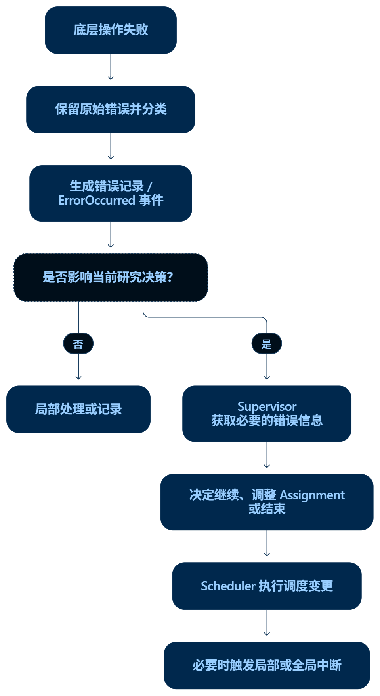
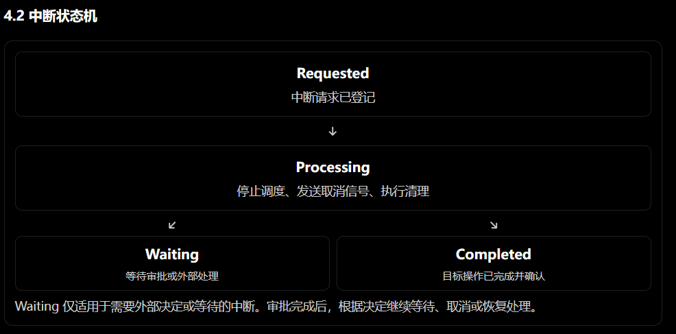
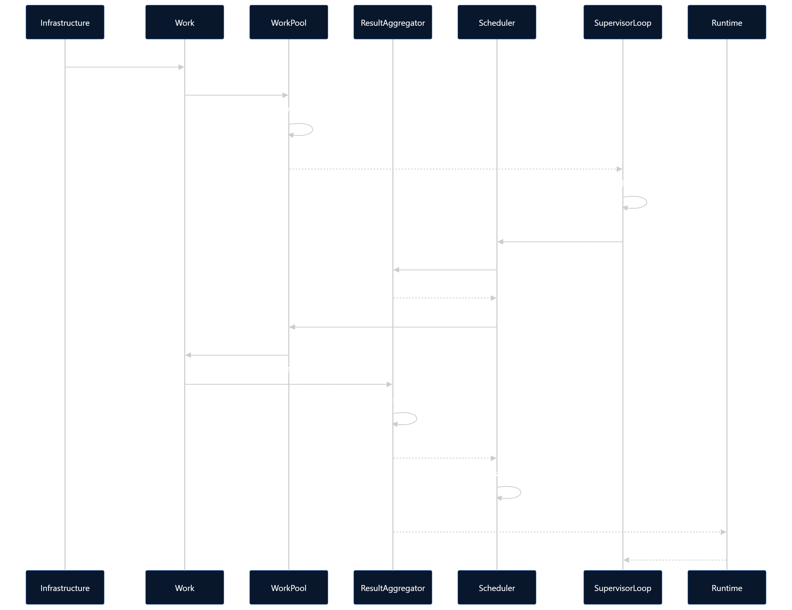

## 9 事件分层、错误分层与中断分层设计

### 9.1 设计目标

系统采用统一的事件通信机制、明确的错误语义和独立的执行中断机制。

三者相互协作，但不共享同一套状态定义：

* Event 负责传递事实、状态变化和控制请求。
* Error 负责描述操作失败及其影响，为错误处理和调度决策提供依据。
* Interrupt 负责管理执行暂停、取消、审批等待与恢复等控制过程。

具体实现可以根据 Go、Eino 和 Runtime 的实际能力调整，但不得混淆错误发生、事件通知、执行中断和研究结果提交这几个不同过程。

### 9.2 事件分层（Event）

#### 9.2.1 事件的基本定位

事件用于表达系统中已经发生的事实，或需要其他组件处理的请求。

建议区分两类事件：

1. 事实事件：描述已经发生的事情，例如 Work 已结束、ResearchState 已提交、Runtime 已销毁。
2. 控制请求事件：请求其他组件执行某项操作，例如请求取消 Work、请求处理审批、请求停止当前研究执行。

两类事件应在语义上有所区分，不能因为发出了控制请求，就认为操作已经成功完成。

#### 9.2.2 事件分类

事件按业务含义分组，不要求为每个事件建立独立的事件系统。

##### A. 生命周期事件

用于表达主要对象的生命周期变化。

示例：

* TaskCreated
* RunTaskStarted
* RuntimeInitialized
* RuntimeDestroyed
* WorkStarted
* WorkFinished
* AssignmentCancelled

##### B. 研究数据事件

用于通知研究数据发生变化。

示例：

* ResultReceived
* ResearchStateCommitted
* ResearchContextUpdated
* FindingGraphUpdated

ResearchStateCommitted 只能在 Commit 成功后发出。ResultReceived 只表示结果已被接收，不代表研究状态已经更新。

##### C. 调度事件

用于协调 Assignment、WorkPool 与 ResultAggregator。

示例：

* AssignmentRegistered
* AssignmentReady
* WorkTimeoutDetected
* ResultCommitFailed
* AssignmentReclaimed

事件通知不能替代必要的状态检查，也不能单凭事件到达顺序推断业务状态。

##### D. 控制事件

用于传递用户控制请求或组件间的执行控制请求。

示例：

* StopRequested
* WorkCancelRequested
* ResumeRequested
* ApprovalRequested
* ApprovalResolved

控制请求应携带必要的 TaskID、RunTaskID、AssignmentID 或 WorkID，以明确作用范围。

##### E. 观测事件

用于向日志、指标、追踪系统或前端推送运行情况。

示例：

* ProgressUpdated
* ModelCallStarted
* ModelCallFinished
* ErrorOccurred
* InterruptStateChanged

观测事件原则上不承担业务状态提交职责。进度事件可以合并或限流，但不可将关键业务提交结果仅保存在可丢弃的观测消息中。

#### 9.2.3 统一事件接口与通信机制

系统沿用统一 EventUnit 与订阅关系设计。组件通过事件接口通信，订阅关系在 Runtime 初始化时配置并建立。

事件至少应具备以下基本信息：

* 事件类型。
* 事件来源。
* 关联的 TaskID、RunTaskID 等必要标识。
* 事件发生时间。
* 与事件类型对应的业务数据。

是否增加 EventID、关联请求 ID、版本号等字段，由实际的去重、追踪和恢复需求决定。

事件发送、事件接收和业务处理应具有清晰边界。Send 成功不代表业务处理成功；如果关键事件需要可靠送达，应通过持久化、确认、重试或可恢复状态等机制保证，不能仅依赖内存广播。

### 9.3 错误分层（Error）

#### 9.3.1 错误的基本定位

Error 描述某项操作未能按预期完成的原因及其影响范围。

错误分类不应只依赖字符串，也不能简单地把所有错误都视为需要重试的失败。错误需要结合发生位置、影响对象、可恢复性和当前执行状态，由相应责任组件处理。

#### 9.3.2 错误层级

##### A. Tool / Model 调用错误

发生于模型调用、MCP Tool、检索或其他外部依赖。

例如：

* 请求参数错误。
* 网络连接失败。
* 模型服务限流。
* 服务暂时不可用。
* 外部工具执行失败。

由 Infrastructure 负责保留原始错误信息并进行必要的分类。是否重试应由明确的重试策略或上层调度决策决定。

##### B. Work 执行错误

发生于某次 SubAgent 执行过程中。

例如：

* Agent 执行失败。
* Work 内部依赖调用失败且无法继续。
* Work 执行上下文被取消。
* Work 超时后进入待处理状态。

Work 错误首先影响当前执行实例，不应自动扩大为整个 RunTask 失败。

Work 超时本身不等于执行失败：按照项目既定策略，超时可以触发待处理状态和审批，由用户决定继续等待或取消。

##### C. Assignment 调度错误

发生于 Assignment 注册、排队、资源分配、取消或回收流程。

例如：

* Assignment 注册失败。
* ResultAggregator 无法预留结果接收槽位。
* WorkPool 无法创建 Work。
* Assignment 状态转换不合法。

由 Scheduler 或相应责任组件处理。不能因为某个 Assignment 失败就直接认定整个研究任务失败。

##### D. Result / ResearchState 提交错误

发生于结果接收、聚合、Commit 或持久化过程中。

例如：

* Result 格式校验失败。
* ResearchState 更新失败。
* 持久化确认失败。
* Commit 过程中出现版本冲突。

这类错误直接关系到研究数据可靠性，应优先保护未提交结果及其必要的恢复信息。

Commit 失败时不得增加 StateVersion，不得向外宣告提交成功，也不得仅因为 Work 已结束就回收对应 Assignment。

##### E. Runtime / 系统级错误

发生于 Runtime 初始化、关键组件失效、恢复或执行协调过程中。

例如：

* Runtime 初始化失败。
* 关键组件无法启动。
* 运行环境无法恢复。
* 系统内部出现不可继续的状态不一致。

此类错误由 Runtime 或上层 Service 协调处理。必要时停止当前执行、记录错误并释放运行资源，但保留 Task、RunTask 和已提交研究数据。

#### 9.3.3 错误对象

建议统一错误包装方式，避免各组件使用互不兼容的错误结构。

错误对象可以包含：

* Code：稳定的错误标识。
* Layer：错误所属层级。
* Message：面向日志和排查的说明。
* Cause：原始错误。
* Scope：错误影响的对象范围。
* Retryable：是否具备重试条件的提示。
* Source：产生错误的组件。
* Timestamp：发生时间。

具体字段可根据实际需要精简。

需要特别注意：

1. Retryable 是错误处理的参考信息，不代表系统必须自动重试。
2. 错误影响范围与严重程度是不同维度。Work 错误不一定轻微，Runtime 错误也不一定意味着所有研究数据损坏。
3. 错误发生后可以产生 ErrorOccurred 事件，但事件只是通知，不代替错误对象或业务状态记录。
4. 不应把所有错误都包装成一个无法区分原因的通用错误，更不能丢弃外部服务返回的关键错误信息。

#### 9.3.4 错误处理责任

* Infrastructure：捕获并保留底层错误，进行必要的错误分类。
* WorkPool：处理 Work 创建、执行与清理阶段的局部错误。
* Scheduler：根据 Assignment 状态及资源情况处理调度错误。
* ResultAggregator：保护结果接收与 Commit 的一致性。
* SupervisorLoop：接收与研究决策相关的失败信息，决定是否调整研究计划。
* Runtime / Service：协调系统级故障、启动失败与恢复流程。

错误的产生者不必负责决定所有后续行为。尤其是模型限流、外部服务故障等情况，应向上层提供足够信息，避免多个 SubAgent 在同一故障下盲目重试。

### 9.4 中断分层（Interrupt）

#### 9.4.1 中断的基本定位

Interrupt 是执行控制过程，不是 Error 的别名，也不是普通事件。

中断可以由用户主动触发、执行超时触发、审批流程触发，或由系统恢复机制触发。

中断的目标是控制特定范围内的执行，使系统能够安全地暂停、取消、等待处理或继续运行。

中断处理需要区分：

* 中断请求是否已收到。
* 中断是否已生效。
* 当前执行是否已停止或进入等待状态。
* 中断处理是否已经完成。
* 执行是否可以恢复。

收到 Interrupt 请求不代表所有相关 Work 已经停止。

#### 9.4.2 中断作用范围

##### A. Work 级局部中断

作用于单个 Work，不直接停止整个 RunTask。

典型情况：

* Work 超时，等待用户决定继续等待还是取消。
* 某个 Work 需要等待审批。
* 用户或调度器请求取消某个 Work。

由 Runtime、WorkPool、Scheduler 等相关组件协调完成。

局部中断不得未经明确决策就扩大为全局 Stop，也不得自动取消其他独立 Work。

##### B. SupervisorLoop 级中断

作用于当前 Supervisor 决策轮次。

典型情况：

* 用户发送新消息，需要优先处理。
* 用户要求停止当前研究执行。
* 当前决策轮次需要让出控制权，处理更高优先级的输入。

此类中断控制的是 SupervisorLoop 的当前决策过程，不等于取消已经提交的 Assignment，也不等于所有运行中的 Work 都必须取消。

##### C. RunTask 级全局中断

作用于当前研究执行。

典型情况：

* 用户主动 Stop 当前研究执行。
* 系统决定终止当前 RunTask 的运行过程。

用户主动 Stop 具有最高控制优先级。Runtime 应协调 SupervisorLoop、Scheduler、WorkPool 及其他运行组件进行停止、取消、收尾和资源释放。

全局中断不删除 Task、RunTask、ResearchState 或已经提交的研究数据。

#### 9.4.3 中断状态与生命周期

中断机制应记录必要的请求信息和处理状态，但不应把所有中断类型都强行塞进 RunTask 的主状态。

RunTask 继续沿用既定的状态语义：

* Running：当前研究执行正常运行。
* Interrupted：存在需要处理的局部中断或审批等待。
* Stopped：用户主动停止当前执行。
* Finish：研究已确认结束。

局部中断可以通过 Work 或相关审批的独立状态表示；当它影响整个研究执行的协调流程时，RunTask 可以进入 Interrupted。

Stopped 与 Finish 必须保持区别：Stopped 后续可以继续执行；Finish 表示当前研究已结束，不自动恢复原研究。

#### 9.4.4 中断处理流程

中断流程遵循以下原则：

1. 接收中断请求，明确中断来源、作用范围及关联对象。
2. 检查当前状态，确定请求是否适用。
3. 更新受影响对象的控制状态，防止后续调度与中断请求冲突。
4. 由相应责任组件执行暂停、取消、等待审批或清理操作。
5. 记录处理结果，并通过事件通知相关组件。
6. 只有在必要的状态检查和清理条件满足后，才确认中断处理完成或允许恢复执行。

中断处理不能依赖单次事件通知来保证完成。对于关键取消与恢复操作，需要通过受控状态转换和必要的确认机制保证最终结果可追踪。

#### 9.4.5 中断与恢复原则

* 用户 Stop 优先级最高，不应被普通研究进度、上下文压缩或普通用户消息覆盖。
* 普通用户消息可以触发当前 Supervisor 决策轮次让出控制权，但不自动取消已提交 Assignment 或正在执行的 Work。
* 局部中断由 Runtime 协调处理，用户不需要直接操作 SubAgent 内部的中断机制。
* Work 被取消后，不自动等同于 Assignment 永久失败，也不自动重试。
* 中断处理完成后是否恢复，应依据中断原因、对象状态及用户决策确定。
* 恢复执行前必须确认旧 Work 已停止或已与共享状态隔离，避免新旧执行并发修改同一份 ResearchState。

### 9.5 三者之间的协作关系

三者通过明确的状态和事件关联，而不是相互替代。

例如，模型服务限流时：

1. Infrastructure 捕获模型调用错误。
2. 错误被分类并传递给相关执行层。
3. 系统可以产生 ErrorOccurred 事件，通知 SupervisorLoop 或 Scheduler。
4. Supervisor 根据研究情况决定调整 Assignment，或等待服务恢复。
5. 只有在确实需要暂停或取消执行时，才进入相应中断流程。

再例如，Work 超时时：

1. WorkPool 检测到超时条件。
2. 系统产生超时相关事件，并更新相应的 WorkInfo。
3. Scheduler 根据项目策略将其标记为待处理状态。
4. 系统发起审批，允许用户选择继续等待或取消。
5. 如果用户取消，则进入局部中断和清理流程；如果继续等待，则继续观察执行状态。

以上过程不应因为出现 Timeout 就自动触发 Retry，也不应将一次局部超时直接转换为整个 RunTask 的失败。

### 9.6 必须保持的设计约束

* 事件通信、错误处理和中断控制是三个独立概念。
* 事件通知成功不代表业务操作成功。
* Work 执行结束不代表 Result 已提交。
* 错误发生不代表必须重试。
* 超时发生不代表必须取消。
* 局部中断不自动升级为全局中断。
* 全局 Stop 不删除持久研究数据。
* Finish 结束当前执行过程，不结束 ResearchState 的生命周期。
* 恢复执行前，必须避免旧执行与新执行并发修改共享状态。
* 所有关键状态转换都应具有明确的责任组件、并发安全保证和可追溯记录。

确立以下四条架构原则：

1. 普通事件走内存队列，关键状态以持久化记录为准。 不要求所有事件都落盘，但关键业务操作必须有可恢复的状态依据，不能依赖一条可能丢失的通知。

2. 底层报告事实，Supervisor 决定研究策略，Scheduler 执行调度决策。 Infrastructure 和 Work 不自行决定整个研究是否重试或换计划。

3. 中断以协作式取消为默认方式。 使用 `context.Context` 传递取消信号，等待 Work 清理完成，再确认停止；`Cancel()` 返回不等于 Work 已停止。

4. 状态变更与事件通知分离。 先保证关键状态转换正确，再发布事件；通知丢失时，系统仍能通过状态记录恢复协调流程。

---

## 10 总体架构与控制边界

### 10.1 Infrastructure / Work

执行与事实采集

捕获模型、Tool、执行和持久化错误；报告 Work 生命周期事实；响应 context 取消。

错误 / 执行结果 / 事实事件

### 10.2 SupervisorLoop

研究策略决策

决定继续研究、调整 Assignment、等待外部依赖或结束研究。

### 10.3 Scheduler

调度执行决策

登记、排队、分配、取消 Assignment，协调 WorkPool。

### 10.4 Runtime + 持久状态层

协调、状态校验、恢复与事件分发

管理事件订阅、关键状态转换、取消确认及运行环境恢复。

这里要特别区分：Supervisor 决定“下一步研究应该怎么做”，Scheduler 决定“具体怎么调度执行”。Scheduler 不应该因为一次模型调用失败，就自行改变研究目标；Supervisor 也不应该直接操作 WorkPool 的内部清理过程。

## 11 事件协议：接口、可靠性与订阅规则

### 11.1 事件接口建议

继续沿用已有的 `EventUnit`、`EventSender` 和 `Contacts` 设计，不额外建立一套消息总线抽象。下面的 Go 代码用于说明最小接口边界。

Go

```go
package event

import (
    "context"
    "time"
)

type Event interface {
    EventType() string
}

type EventMeta struct {
    EventID    string
    Source     string
    TaskID     string
    RunTaskID  string
    OccurredAt time.Time
}

type EventEnvelope struct {
    Meta EventMeta
    Data Event
}

type EventSender interface {
    Send(ctx context.Context, e EventEnvelope) error
}

type EventAcceptor interface {
    Accept(ctx context.Context, e EventEnvelope) error
}

type Contacts struct {
    Subscribers []EventSender
}
```

接口的职责边界：

* `Event` 描述事件的业务类型及数据。

* `EventEnvelope` 提供统一的事件元数据。

* `Send` 负责将事件交给目标接收机制，不代表订阅者已经完成业务处理。

* `Accept` 是可选的快速接纳能力，例如将事件放入内存队列；不要求每个组件都实现。

* `Contacts` 保存当前事件源的订阅者。外部通过 `EventSender` 发送，不直接操作订阅者内部队列。

`EventID` 用于关键事件的去重与追踪。普通进度事件不必建立复杂的确认协议；关键状态则必须有持久化或可恢复的状态依据。

### 11.2 两种送达策略

普通事件：内存队列

适用于进度、模型调用观测、可重新计算的上下文刷新通知等。

允许合并、限流或在队列拥塞时丢弃明确标记为可丢弃的通知。丢失后不应导致业务状态永久错误。

关键业务状态：持久化或可恢复状态

适用于 ResearchState Commit、Assignment 取消、结果提交状态和关键中断状态。

先完成必要的状态记录，再发送通知。若通知丢失，恢复流程可重新读取状态，判断哪些后续动作尚未完成。

这里不必要求每个关键事件都单独写一条持久化消息。可以采用两种实现：

* 状态驱动恢复：持久化当前状态和必要的待处理信息，恢复时扫描状态并继续处理。

* 事务性 Outbox：如果关键状态写入与通知记录必须原子提交，可将两者写入同一可靠存储，再异步发送通知。

对当前项目，建议先实现状态驱动恢复；只有确实需要可靠事件重放或跨进程投递时，再引入 Outbox。

注意：如果状态和事件分别写入两个不具备原子性的存储，就不能宣称两者原子提交。即使采用内存事件队列，也必须通过状态恢复弥补通知丢失。

### 11.3 事件订阅规则

延续已经确定的语义：

> A 订阅 B = A 愿意接收 B 发出的事件。

初始化时读取统一订阅配置，构建每个事件源的 `Contacts`，校验非法组件、重复关系和缺失订阅者。

订阅关系只负责确定通知去向，不决定业务状态所有权。即使多个组件收到同一事件，也必须遵守各自的写入职责。

对于可能重复投递的关键通知，接收方应通过 `EventID`、对象版本或当前持久化状态进行幂等处理，避免重复执行不可重复的状态转换。

## 12 错误协议：错误分类、决策权与流转

### 12.1 统一错误结构

建议在项目内部建立统一的错误描述，但保留 Go 的 `error`、`errors.Is`、`errors.As` 语义。不要把所有错误都变成字符串，也不要用 `Retryable bool` 单独决定是否重试。

```go
package fault

import (
    "errors"
    "fmt"
)

type Layer string

const (
    LayerInfrastructure Layer = "infrastructure"
    LayerWork           Layer = "work"
    LayerScheduler      Layer = "scheduler"
    LayerResult         Layer = "result"
    LayerRuntime        Layer = "runtime"
)

type Code string

const (
    CodeInvalidInput  Code = "invalid_input"
    CodeRateLimited   Code = "rate_limited"
    CodeUnavailable   Code = "unavailable"
    CodeToolFailed    Code = "tool_failed"
    CodeWorkTimeout   Code = "work_timeout"
    CodeWorkCanceled  Code = "work_canceled"
    CodeCommitFailed  Code = "commit_failed"
    CodeStateConflict Code = "state_conflict"
    CodeInternal      Code = "internal"
)

type Error struct {
    Code   Code
    Layer  Layer
    Source string

    TaskID       string
    RunTaskID    string
    AssignmentID string
    WorkID       string

    RetryableHint bool
    Err           error
}

func (e *Error) Error() string {
    if e.Err != nil {
        return fmt.Sprintf("%s: %v", e.Code, e.Err)
    }
    return string(e.Code)
}

func (e *Error) Unwrap() error {
    return e.Err
}

func Wrap(code Code, layer Layer, source string, err error) *Error {
    if err == nil {
        return nil
    }
    var existing *Error
    if errors.As(err, &existing) {
        return existing
    }
    return &Error{
        Code:   code,
        Layer:  layer,
        Source: source,
        Err:    err,
    }
}
```

这是最小示例。正式实现还需要根据需要补充错误影响范围、发生时间等字段。示例中的 `RetryableHint` 仅是提示，不是自动重试命令。

### 12.2 错误决策分工

| 错误发生位置               | 负责提供的信息                | 决策责任               |
| -------------------- | ---------------------- | ------------------ |
| Infrastructure       | 原始错误、错误码、限流或服务不可用等分类   | 不决定整体研究计划          |
| Work / SubAgent      | 本次执行成功、失败、超时或取消的结果     | 不擅自重试整个 Assignment |
| Scheduler / WorkPool | 调度失败、资源不足、取消及清理结果      | 执行调度和资源处理策略        |
| ResultAggregator     | Result 接收、Commit 成功或失败 | 保证结果提交与版本状态正确      |
| SupervisorLoop       | 汇总影响研究进度的失败信息          | 决定调整计划、继续研究或结束研究   |
| Runtime / Service    | 初始化、恢复、全局控制异常          | 协调执行环境和系统生命周期      |

例如模型服务限流时，Infrastructure 应报告 `CodeRateLimited`，而不是在每个 Work 内部无限重试。Supervisor 可以决定暂时等待、调整 Assignment 或结束研究；Scheduler 再根据该决策调整调度。

### 12.3 错误处理流程



需要补充一个例外：ResearchState Commit 失败等关键数据错误，不能只等待 Supervisor 决策。ResultAggregator 必须立即保护未提交数据、保留必要的恢复信息，并禁止错误地确认提交成功。Supervisor 决定的是研究策略，而不是是否可以忽略数据一致性约束。

### 12.4 错误与重试规则

重试必须同时考虑错误类型、当前状态、重试预算和副作用，而不只是判断错误是否可恢复。

* 模型限流：可以等待或退避，但应避免多个 Work 同时无节制重试。

* Tool 调用失败：是否重试取决于工具的幂等性及错误性质。

* Work 超时：按既定设计进入待处理流程，不自动取消或重试。

* Work 取消：是控制流程的结果，不应一律作为普通失败。

* Commit 失败：保留必要的未提交结果与恢复信息，不能直接回收 Assignment。

* Runtime 初始化失败：记录失败原因，清理未成功启动的运行资源，但保留 Task、RunTask 和已提交研究数据。

错误记录与事件通知用于观察和协调；它们都不能代替真正的状态变更。

## 13 中断协议：请求、执行、确认、恢复

### 13.1 接口边界

中断接口需要区分“发出取消信号”和“确认执行已经停止”。建议 Runtime 提供统一的中断协调能力，由 WorkPool 等具体执行组件负责局部取消和清理。

```go
package interrupt

import (
    "context"
    "time"
)

type Scope string

const (
    ScopeWork         Scope = "work"
    ScopeSupervisor   Scope = "supervisor"
    ScopeRunTask      Scope = "run_task"
)

type Kind string

const (
    KindCancel   Kind = "cancel"
    KindStop     Kind = "stop"
    KindApproval Kind = "approval"
    KindYield    Kind = "yield"
)

type Status string

const (
    StatusRequested  Status = "requested"
    StatusProcessing Status = "processing"
    StatusWaiting    Status = "waiting"
    StatusCompleted  Status = "completed"
    StatusRejected   Status = "rejected"
)

type Request struct {
    ID           string
    Scope        Scope
    Kind         Kind
    TaskID       string
    RunTaskID    string
    AssignmentID string
    WorkID       string
    Reason       string
    RequestedAt  time.Time
}

type Result struct {
    RequestID string
    Status    Status
    Err       error
}

type Controller interface {
    Request(ctx context.Context, req Request) (Result, error)
    GetStatus(ctx context.Context, requestID string) (Result, error)
}

```

这里的 `Controller` 表示中断协调入口，不意味着所有中断必须同步等待到完成。对于可能长时间运行的取消操作，可以先记录请求并返回 `StatusRequested` 或 `StatusProcessing`，再通过事件和状态查询追踪处理进度。

接口也不要求直接暴露 Work 的 `context.CancelFunc`。取消函数属于具体执行实例的内部资源，应由负责其生命周期的组件持有。

### 13.2 中断状态机



`Rejected` 表示请求因状态不允许、对象不存在或权限等原因未被接受，不应与执行失败混为一谈。处理过程中发生的错误则应保留在 `Result.Err` 或关联错误记录中。

对于已经完成的中断请求，重复提交同一个请求 ID 应返回既有结果或当前状态，避免重复执行不可重复的清理动作。

### 13.3 Work 级取消流程

Work 级取消是最重要的局部中断场景。

1. Scheduler 或 Runtime 接收到取消请求。

2. 记录请求，并阻止该 Work 被重复调度或启动新的执行尝试。

3. WorkPool 找到目标 Work，调用其内部的 `CancelFunc`。

4. Work 通过 `ctx.Done()` 感知取消信号，在允许的位置停止继续执行。

5. Work 执行必要的清理，返回最终执行状态。

6. WorkPool 确认 Work 已退出，并更新 WorkInfo。

7. Scheduler 与 ResultAggregator 协调 Assignment 和结果槽位的后续状态。

8. 所有必要条件满足后，才将取消处理标记为 `Completed`。

取消信号已发送，不等于 Work 已停止；Work 已停止，也不等于 Assignment 已回收。

如果 SubAgent 或外部 Tool 不响应 `context.Context`，Go 无法安全地强制终止任意 goroutine。因此，本项目的协作式取消只能在组件遵守取消协议的前提下保证退出。对于不可信或可能永久阻塞的执行环境，未来若采用独立进程或容器隔离，才可以进一步设计进程级终止机制。

### 13.4 RunTask 全局 Stop 流程

用户主动 Stop 当前研究执行时，Runtime 负责协调整个运行环境。

建议流程如下：

1. 记录全局 Stop 请求，并阻止新 Assignment 被启动。

2. 通知 SupervisorLoop 停止当前决策轮次。

3. 通知 Scheduler 停止继续调度。

4. 由 WorkPool 对运行中的 Work 发出取消信号，并等待协作式退出。

5. 收集最终执行状态，协调未提交结果和待处理的结果槽位。

6. 完成必要的持久化、状态更新和资源清理。

7. 确认当前执行已停止后，将 RunTask 置为 `Stopped`。

8. 销毁或释放不再需要的 Runtime 运行组件，但保留 Task、RunTask、ResearchState 和已提交数据。

如果部分 Work 迟迟不能退出，不能仅因为取消超时就谎报全局停止完成。系统应保留未完成的清理状态，阻止新的执行与旧 Work 并发修改共享 ResearchState。

### 13.5 中断与 SupervisorLoop

用户普通消息与全局 Stop 需要区分：

* 普通消息：进入输入队列，在 SupervisorLoop 的安全点请求让出当前决策轮次，再处理新输入。

* 全局 Stop：最高优先级，阻止新的调度，并协调运行中的 Work 退出。

* 局部 Work 中断：只影响对应 Work；如果需要用户审批，RunTask 可以进入 `Interrupted`，但不应自动取消其他独立 Work。

* 审批答复：由 Runtime 根据待审批请求及其状态识别，并将决定交给对应的处理流程，不需要额外构造一套与审批状态重复的优先级系统。

中断不应破坏已经完成的 ResearchState Commit。若中断发生在提交期间，必须通过提交操作自身的原子性与恢复机制确定最终结果，不能简单地通过取消 context 假定提交已经回滚。

## 14 统一状态转换表

建议将 RunTask、Assignment、Work、Result 提交和中断请求的状态分开维护。以下是需要实现的关键转换，不要求所有字段都放在同一个结构体里。

| 对象         | 当前状态                  | 触发条件           | 后续状态               |
| ---------- | --------------------- | -------------- | ------------------ |
| RunTask    | Running               | 存在需要处理的局部中断或审批 | Interrupted        |
| RunTask    | Running / Interrupted | 用户主动 Stop      | Stopped            |
| RunTask    | Stopped               | 新消息通过准入并重新启动执行 | Running            |
| RunTask    | Running / Interrupted | 研究确认结束         | Finish             |
| Assignment | 已登记                   | 资源允许执行         | 调度中 / 执行中          |
| Assignment | 执行中                   | Work 结束，结果待处理  | 等待结果提交             |
| Assignment | 等待结果提交                | Commit 成功      | 可回收                |
| Assignment | 任意未终结状态               | 收到取消请求         | 取消处理中              |
| Work       | Running               | 收到取消信号         | Canceling（或等价内部状态） |
| Work       | Canceling             | 执行退出并完成必要清理    | Canceled           |
| Work       | Running               | 正常执行结束         | Succeeded / Failed |
| Result     | 已接收                   | 聚合并 Commit 成功  | Committed          |
| Result     | 已接收                   | Commit 失败      | CommitFailed / 待恢复 |
| Interrupt  | Requested             | 开始处理           | Processing         |
| Interrupt  | Processing            | 需要等待审批或外部决定    | Waiting            |
| Interrupt  | Processing            | 目标操作完成且已确认     | Completed          |

这张表有意保留了不同对象的状态边界。比如 Work 的 `Succeeded` 与 Result 的 `Committed` 并不相同；Assignment 的“可回收”也不意味着 WorkInfo 必须立刻删除。

## 15 事件流示例：一次 Work 失败后调整研究计划



上图展示的是调整计划后的一次后续执行，不代表所有错误都必须创建新 Work。是否重试、是否调整 Assignment，应由错误性质和 Supervisor 的研究决策共同决定。

另外，`ResearchStateCommitted` 的通知即使丢失，ResearchState 的持久状态仍然是权威依据。Runtime 重建或事件恢复机制应能够发现状态已经提交，并补做必要的上下文刷新和调度收尾。

## 16 最终约束

事件、错误与中断的实现约束

### 16.1 事件、错误与中断的实现约束

1. 普通事件通过内存队列通信；关键业务状态必须具备持久化或可恢复依据，不依赖单条内存通知保证正确性。

2. 事件发送成功不代表业务处理成功；控制请求发出不代表控制操作已经完成。

3. 底层组件负责捕获和分类错误，Supervisor 负责研究策略决策，Scheduler 负责调度决策的执行。

4. Work 超时不自动等同于失败、取消或重试；具体行为遵循既定的审批和调度策略。

5. Work 取消优先采用 context 取消与协作式退出。只有确认 Work 已退出并完成必要清理，才能确认该 Work 的取消处理完成。

6. Work 执行状态、Result 提交状态、Assignment 调度状态和 Interrupt 处理状态分别维护，不得互相替代。

7. 用户主动 Stop 具有最高控制优先级。停止过程中应阻止新调度，并协调正在执行的 Work 退出。

8. 中断和停止不得删除已提交的 ResearchState 数据，也不得绕过 ResultAggregator 的一致性约束。

9. 所有关键状态转换必须具备明确的责任组件、并发安全保证和恢复依据。

10. 关键事件或控制请求可能重复处理，因此必须根据对象 ID、请求 ID、版本或持久化状态实现必要的幂等性。

11. Runtime 重建时，应根据持久化状态和可恢复记录恢复必要的协调工作，不能假设旧 Runtime 的内存事件队列仍然存在。

12. 不要求所有事件都持久化，也不要求所有中断同步等待完成；可靠性要求应与事件重要性和操作语义相匹配。

最后，我建议优先实现的最小闭环是：统一错误对象、内存事件队列、WorkInfo 状态保护、Work 协作式取消、ResultAggregator 的 Commit 确认，以及 RunTask Stop 的协调流程。先通过这条闭环验证状态转换与故障恢复，再扩展更细的事件类型和持久化通知机制。

这样不会一开始就把项目做成复杂的通用事件平台，同时能够守住你最在意的三件事：研究数据不能因运行时销毁而丢失、执行状态不能因并发而互相矛盾、局部失败不能不受控制地扩大成整个研究失败

---